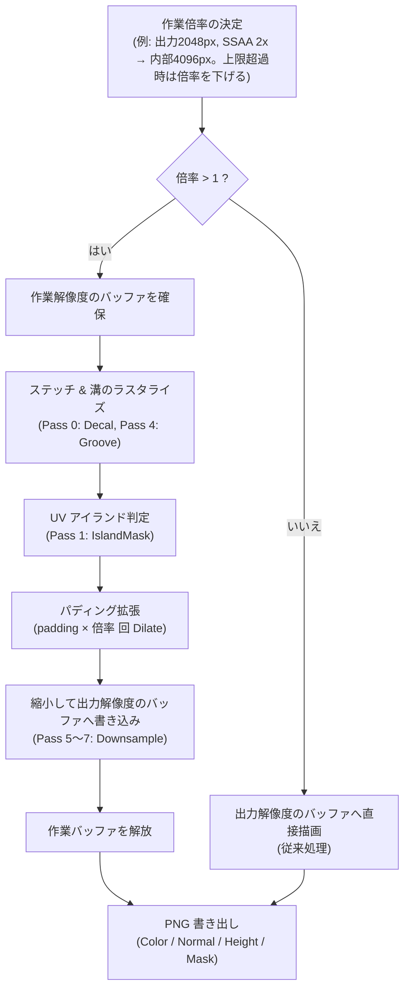

# アンチエイリアシング（SSAA）実装計画書

## 1. 概要と目的

### 1.1 背景
StitchMaker は 3D モデルの UV 空間上にステッチ（縫い目）のデカールポリゴンをラスタライズし、Color / Normal / Height / Mask の各種テクスチャをベイク出力します。
現状の実装では、指定された出力解像度（512〜4096px）の RenderTexture に対して直接レンダリングを行っているため、特に斜め方向のステッチや曲線パス、マスク境界においてピクセルの階段状のギザギザ（ジャギー）が発生しやすい課題があります。

### 1.2 目的
ベイクパイプライン内に **SSAA（Super-Sample Anti-Aliasing: スーパーサンプリング・アンチエイリアシング）** 処理を組み込み、輪郭や法線が滑らかなステッチテクスチャをワンクリックで出力できるようにします。

---

## 2. 方式選定：なぜ SSAA なのか

| 項目 | ハードウェア MSAA (Multi-Sample) | SSAA (Super-Sample) ★採用 |
| :--- | :--- | :--- |
| **対象** | ポリゴンの幾何エッジのみ | **シェーダー計算・マスク境界・溝・全画素** |
| **MRT (多重ターゲット) 互換性** | Unity/GPU環境依存で制約が多く不安定 | **完全互換（プラットフォーム非依存）** |
| **マスクによるディスカード** | `discard` やアルファテスト境界には無効 | **高解像度でマスクを評価するため滑らか** |
| **法線マップの品質** | 法線の傾き変化には効かない | **微細な凹凸や傾き変化も高密度サンプリング** |
| **パディング (Dilate) 連携** | MSAA バッファ直接の Dilate は困難 | **高解像度のまま高精度パディングが可能** |

**選定理由:**
StitchMaker のステッチ形状は「四角形ポリゴン内にマスクテクスチャを評価して描画」しており、輪郭の多くはポリゴン境界ではなくシェーダー内のマスク値（被覆率 `saturate(m × 20)`）で決まります。ポリゴン境界のみを対象とする MSAA では効果が薄いため、**内部で高解像度レンダリングを行い最後に縮小する SSAA** を採用します。

---

## 3. 基本仕様・設計方針

### 3.1 アンチエイリアス倍率設定
`ExportSettings` に SSAA 倍率 `ssaa` を追加します（既定値 `2`）。

- **OFF (1x)**: 従来通りの解像度で直接レンダリング（最速・低負荷）。
- **2x (推奨)**: 縦横 2 倍（面積 4 倍）の解像度でレンダリング後、1/2 に縮小。
- **4x (高画質)**: 縦横 4 倍（面積 16 倍）の解像度でレンダリング後、1/4 に縮小。

不正な値（保存データの破損・手編集など）は 1 / 2 / 4 のうち、値以下で最大のものに丸めます（1 未満は 1）。
既存の `.asset` には `ssaa` が無いため、読み込み時はフィールド初期値の `2` になります。

### 3.2 適用範囲：出力時のみ（プレビューは 1x）
`TextureBaker.Render` はシーンビューのプレビュー（編集のたびに再ベイク）と、テクスチャ出力の両方から呼ばれます。
プレビューにも SSAA を掛けると、ノードのドラッグ中に毎回 4〜16 倍の画素を描画することになり、要件定義書 §9.1 のパフォーマンス目標（変更からプレビュー反映まで 100ms 以内）を満たせません。

- **プレビュー**: 常に 1x で描画する（出力解像度は同じ。アンチエイリアスの有無だけが異なる）。
- **テクスチャ出力**: `export.ssaa` の倍率で描画する。
- `Render(snapshot, document, ssaa)` のように倍率を引数で受け取り、呼び出し側（ウィンドウ）が使い分けます。
- 要件定義書 §2「プレビューと出力は同じパイプライン・同じ解像度」の例外として明記します（パイプライン・最終解像度は共通で、内部の作業解像度だけが異なる）。

### 3.3 解像度上限ガード（8192px 制約）
内部作業解像度（`resolution × ssaa`）は **`min(8192, SystemInfo.maxTextureSize)` まで** に制限します。
上限を超える場合は倍率を 4 → 2 → 1 と半分にして収まる最大の整数倍率を使います（縮小を整数倍の Box Filter にするため、非整数倍率にはしません）。

| 出力解像度 | SSAA 1x | SSAA 2x | SSAA 4x |
| :---: | :---: | :---: | :---: |
| **512** | 512 | 1024 | 2048 |
| **1024** | 1024 | 2048 | 4096 |
| **2048** | 2048 | 4096 | 8192 |
| **4096** | 4096 | 8192 | **8192（クランプ: 実質 2x）** |

- UI では、選択中の設定でクランプが発生する場合に注記ラベルを表示します。
- **VRAM の目安**: 作業解像度 8192px では ARGB32 4 枚（Color / Normal とそれぞれの Dilate 用一時バッファ）で約 1GB、R8 4 枚で約 256MB、深度で約 256MB、合計 **約 1.5GB** を一時的に使用します。

### 3.4 作業バッファの管理
- 出力解像度のバッファ（`Color` / `Normal` / `Height`。プレビューと Export が参照）は従来通り常駐させます。
- 高解像度の作業バッファは **SSAA 出力時のみ確保し、縮小後に `try / finally` で必ず解放** します（常駐させると最大 1.5GB の VRAM を占有し続けるため）。
- `RenderTexture.Create()` が失敗した場合は例外を投げ、ウィンドウの既存のエラー処理（ステータスバーに「出力に失敗しました: …」）に乗せます。
- 実装上は、1 組のターゲット（Color / Normal / Height と各一時バッファ、アイランドマスク、深度）を内部クラスにまとめ、「出力解像度の組」と「作業解像度の組」を同じ描画コードで扱います。

### 3.5 レンダリング＆パディングのパイプライン順序



> [!NOTE]
> **パディングを高解像度側で行う理由:**
> パディングを高解像度側で `padding × 倍率` 回実行してから縮小すると、出力解像度での拡張幅は従来と同じ `padding` px になります。
> さらに UV アイランド境界をまたぐ出力画素が「アイランド内の値」と「拡張値」の平均になるため、境界が自然に溶け込みます。

---

## 4. 各テクスチャのダウンサンプリング仕様

縮小は `Graphics.Blit(作業バッファ, 出力バッファ, material, pass)` で行い、シェーダー内で出力 1 画素に対応する `倍率 × 倍率` 個の作業画素をテクセル中心で読み（`tex2Dlod`）平均します（Box Filter）。
倍率は `_Factor` で渡します（2 → 4 サンプル、4 → 16 サンプル）。

単純なバイリニア縮小では以下の問題が出るため、マップごとに専用の Pass を用意します。
1. **Color (RGB + A)**: 被覆率 0 の画素の RGB が混ざり、半透明境界に色ズレ（フリンジ）が出る。
2. **Normal (XYZ)**: ベクトル平均で長さが縮み（$|\vec{N}| < 1$）、平坦化や暗化が起きる。
3. **Height**: リニア平均で縮小すれば十分。

### 4.1 Color ダウンサンプリング（Pass 5）
- 被覆率（A）による加重平均で RGB を求めます。
  $$\text{RGB}_{\text{down}} = \frac{\sum (C_i \cdot A_i)}{\sum A_i}$$
  $$A_{\text{down}} = \text{Average}(A_i)$$
- $\sum A_i$ がほぼ 0（被覆の無いブロック）の場合は RGB の単純平均を使います。
  - Decal パスは被覆率 0 の画素にも糸色を書き、ステッチ周囲の RGB を糸色で埋めています（要件定義書 §7.4。バイリニア補間時の黒フチ防止）。加重平均だけだと被覆 0 のブロックが黒 (0/ε) になりこの性質が壊れるため、単純平均で糸色を保ちます。
- Color の RenderTexture は sRGB のため、サンプリング値はリニアに変換済みで、平均はリニア空間で行われます（書き込み時に sRGB へ戻る）。
- **Mask** は Color の A をそのまま書き出すため、Color の縮小で同時に処理されます（専用 Pass は不要）。

### 4.2 Normal ダウンサンプリング（Pass 6）
- 法線をアンパックして平均し、**再正規化** します。
  $$\vec{N} = \text{normalize}\left(\text{Average}(\vec{n}_i \cdot 2 - 1)\right)$$
  $$\text{Normal}_{\text{out}} = \vec{N} \cdot 0.5 + 0.5$$
- 平均がほぼ 0 ベクトルになった場合は平らな法線 `(0, 0, 1)` を使います（NaN 防止）。
- A は 1 を書きます（透過出力時の Normal のアルファは Export で Color の A から作るため、ここで保持する必要はありません）。

### 4.3 Height ダウンサンプリング（Pass 7）
- R の算術平均（Box Filter）。R8 Linear なので変換は不要です。

---

## 5. 詳細実装計画と変更対象ファイル

### 5.1 データモデルの拡張
- **対象**: [`Editor/Data/StitchDocument.cs`](../../Editor/Data/StitchDocument.cs)
- `ExportSettings` に追加:
  ```csharp
  public int ssaa = 2; // 1: OFF, 2: 2x（推奨）, 4: 4x
  ```

### 5.2 シェーダーへのダウンサンプリング Pass 追加
- **対象**: [`Editor/Shaders/StitchBake.shader`](../../Editor/Shaders/StitchBake.shader)
- `Pass 5: DownsampleColor`（被覆率加重平均。被覆 0 は単純平均）
- `Pass 6: DownsampleNormal`（平均 + 再正規化）
- `Pass 7: DownsampleHeight`（算術平均）
- サンプル位置の計算は 3 Pass で共通の関数にします。

### 5.3 ベイク処理の更新
- **対象**: [`Editor/Core/TextureBaker.cs`](../../Editor/Core/TextureBaker.cs)
- ターゲット一式を内部クラスにまとめるリファクタリング（挙動は変えない）。
- `Render(MeshSnapshot, StitchDocument, int ssaa)`:
  - 有効倍率を §3.3 の規則で決定。
  - 倍率 1: 出力解像度の組へ直接描画（従来通り）。
  - 倍率 > 1: 作業解像度の組を確保 → 描画・Dilate（`padding × 倍率` 回）→ Pass 5〜7 で出力解像度の組へ縮小 → 解放。
- 有効倍率を返す静的メソッド（UI の注記表示でも使用）を用意します。

### 5.4 ウィンドウ・UI とローカライズの更新
- **対象**:
  - [`Editor/UI/StitchMakerWindow.uxml`](../../Editor/UI/StitchMakerWindow.uxml)
  - [`Editor/UI/StitchMakerWindow.cs`](../../Editor/UI/StitchMakerWindow.cs)
  - [`Editor/UI/Loc.cs`](../../Editor/UI/Loc.cs)
  - [`Editor/DennokoUIFont.cs`](../../Editor/DennokoUIFont.cs)（`WarmupJapanese` へ新しい文字を追記）
- プレビューの `Bake()` は倍率 1、`ExportTextures()` は `export.ssaa` で `Render` を呼ぶ。
- 出力設定の「パディング」の下に「アンチエイリアス」ドロップダウンを追加。
  - 選択肢: `OFF` / `2x` / `4x`（言語に依存しない表記）。
  - ツールチップで「出力時のみ適用、プレビューは対象外」「2x 推奨」を説明。
- 解像度 × 倍率が上限を超える場合に、実際の倍率を示す注記ラベルを表示。
- 日本語・英語の対訳を追加。

### 5.5 ドキュメントの更新
- **対象**:
  - [`Docs/user_manual_ja.md`](../user_manual_ja.md) / [`Docs/user_manual_en.md`](../user_manual_en.md): 出力設定に「アンチエイリアス」の項目を追記（推奨は 2x、4096px での制限、プレビューには反映されない旨）。
  - [`Docs/Impl/requirements.md`](requirements.md): `ExportSettings` の既定値、§2 の方針の例外、§7.4 の Pass 5〜7、§8.3 の「出力は現在のプレビューと同一の RenderTexture から行う」の記述を更新。
- PDF 版マニュアルの再生成は本作業の対象外とします。

---

## 6. 実装フェーズ（コミット単位）

| # | 作業内容 | 対象 |
| :--- | :--- | :--- |
| 1 | `StitchBake.shader` に Downsample Pass 5〜7 を追加 | `StitchBake.shader` |
| 2 | `ExportSettings` に `ssaa` を追加 | `StitchDocument.cs` |
| 3 | `TextureBaker` のターゲット一式を内部クラスへ整理（挙動変更なし） | `TextureBaker.cs` |
| 4 | `TextureBaker` に SSAA パイプラインを実装し、出力時のみ倍率を渡す | `TextureBaker.cs`, `StitchMakerWindow.cs` |
| 5 | UI にアンチエイリアス設定と注記を追加、日英翻訳・フォント文字を追記 | `StitchMakerWindow.*`, `Loc.cs`, `DennokoUIFont.cs` |
| 6 | ユーザーマニュアル・要件定義書を更新 | `user_manual_*.md`, `requirements.md` |

---

## 7. 検証・品質テスト基準

1. **輪郭のスムーズさの比較**: 斜め 45 度・曲線のステッチを OFF / 2x / 4x で出力し、Color と Normal のジャギー低減を拡大確認する。
2. **Normal マップの整合性**: 縮小後も法線が歪まず、立体感（明暗・光沢）が維持されていること。
3. **透過境界のフリンジ検証**: Color のエッジに黒い縁取りや色ズレが無いこと。「ステッチ以外を透過」ON で Normal / Height のアルファ境界も確認する。
4. **パディング**: 出力解像度での拡張幅が従来と同じ（`padding` px）で、UV シーム付近に継ぎ目が出ないこと。
5. **4096px 出力時の安定性**: 4096px で 2x / 4x を指定し、8192px へのクランプと注記表示が機能し、エラーなく書き出せること。出力後に VRAM が解放されていること（Profiler の Memory で確認）。
6. **プレビュー性能**: SSAA 設定に関係なく、ドラッグ中のプレビューの重さが従来と変わらないこと。
7. **互換性**: `ssaa` を持たない既存の `.asset` を読み込むと 2x になること。Unity 2022.3 / Unity 6 でコンパイル警告が出ないこと。
