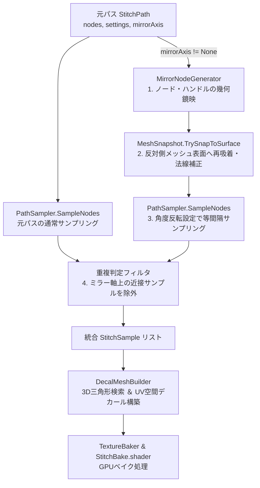

# StitchMaker ミラー機能 設計・実装仕様書（レベル2非対称メッシュ対応版）

本ドキュメントは、Unity向けステッチオーサリング拡張機能「**StitchMaker**」におけるミラー（鏡映反転）機能の設計・アルゴリズム・実装計画をまとめた完全仕様書です。  
ツールの既存実装や3D幾何計算の背景知識がない開発者でも、本ドキュメントを読むだけで実装方針を把握し、作業に着手できるように構成しています。

---

## 1. ツールの基本アーキテクチャと背景

### 1.1 StitchMaker とは
3Dモデル（靴、衣装、手袋など）の表面上にインタラクティブにステッチ（縫い目）のパスを配置し、ステッチマスクテクスチャを元に **Color / Normal / Height / Mask テクスチャへGPUベイク** するUnityエディタ拡張機能です。

### 1.2 座標系とデータ構造
* **メッシュ空間（Mesh Space）**:  
  すべての幾何計算（制御点・法線・ベジェ曲線）は対象 `Renderer` のメッシュローカル空間（Transformのスケールは適用、位置・回転は除外）で行われます。これにより、オブジェクトのワールド移動や回転の影響を受けずに安定して計算できます。
* **パス表現（`StitchPath` と `StitchNode`）**:  
  ユーザーがメッシュ表面上をクリックして配置する制御点（`StitchNode`）のリストで構成されます。  
  各ノードは `position`（位置）、`normal`（法線）、`handleIn` / `handleOut`（3次ベジェのハンドル相対ベクトル）を保持します。
* **メッシュ情報キャッシュ（`MeshSnapshot`）**:  
  対象メッシュの頂点・法線・接線・UV・三角形インデックスを読み込み、64分割の均一空間グリッド（Uniform Grid / CSR形式）を構築して、高速なレイキャストや三角形範囲検索を提供します。

### 1.3 既存のステッチ生成〜ベイクパイプライン
1. **曲線補間**: `PathSampler` がノード間を3次ベジェ曲線として16分割評価し、滑らかなポリラインを生成。
2. **等間隔離散化**: 指定ピッチ（`spacing`）ごとに進み、ステッチ1粒ずつの位置・接線・法線（`StitchSample`）を算出。
3. **デカールメッシュ構築（`DecalMeshBuilder`）**:  
   各 `StitchSample` を中心とする小さな直方体デカール（幅 `width`、長さ `length`、深度 `depthTolerance`）を生成。下層のメッシュ三角形と交差判定を行い、交差ポリゴンをステッチ局所座標 $(u, v, d)$ に変換した上で、頂点座標を **対象メッシュのUV0座標** に置き換えた特殊なデカールメッシュを出力。
4. **GPUベイク（`TextureBaker` & `StitchBake.shader`）**:  
   UV空間で描画されるデカールメッシュを `Graphics.DrawMeshNow` でレンダリングし、ステッチマスクをサンプリングして Color / Normal / Height / Mask テクスチャを生成。

---

## 2. ミラー機能の目的と課題（UVミラー vs 3Dミラー）

### 2.1 ミラー機能の必要性
衣装や靴、襟、手袋などは、左右対称（または特定軸に対称）にデザインされるケースが大多数です。片側（例: 右足）で作成したステッチパスを反対側（例: 左足）へ自動的・対称に反映させることで、作業効率を倍増させ、左右のクオリティ差を排除します。

### 2.2 なぜ「UVミラー」ではなく「3D空間ミラー」が本質的なのか？

| 比較項目 | UV空間ミラー | 3D空間ミラー（本仕様） |
| :--- | :--- | :--- |
| **アバターのUV構造** | 破綻しやすい（左右で別々のUVアイランドに配置されているモデルが一般的） | **完全対応**（反対側の3D三角形を参照し、その三角形固有のUV0を取得するため無関係） |
| **UVの回転・歪み** | 左右のUVアイランドの向きやスケールが違うとステッチが歪む・斜めになる | **完全対応**（3D空間上で等間隔に配置されるため、UVの歪みの影響を受けない） |
| **UVシーム（継ぎ目）** | シームを跨ぐミラーリングが極めて困難 | **自動対応**（既存の `DecalMeshBuilder` が3D交差から自動的にシームを跨ぐUVメッシュを生成） |
| **適用範囲** | UVが完全に中央対称に展開されている一部のモデルのみ | **あらゆるVRChatアバター・衣装モデル** |

> **結論**:  
> StitchMakerのパイプラインでは、**3D空間上で反対側の位置へ反転し、既存の `DecalMeshBuilder` に渡す** 方式を採ることで、左右でUVアイランドが分かれている一般的なモデルであっても、追加のUV処理なしに完璧に反対側のUV位置へベイクされます。

---

## 3. 非対称メッシュ（Asymmetric Mesh）への対応方針

多くのアバターや衣装は完全な数学的対称（左右の頂点座標が完全に一致）ではなく、スカルプトの左右差、ポーズの微妙な傾き、シワの非対称性を持っています。

### 3.1 非対称性の3つのレベルと対策

1. **レベル1（微小な誤差：数mm未満）**
   * **現象**: 頂点の微妙な揺らぎ。
   * **対策**: 既存の `DecalMeshBuilder` が持つ投影深度マージン（`depthTolerance` = $1\text{ cm}$ 程度）によって自動的に吸収されます。
2. **レベル2（中程度の誤差：数mm 〜 数cm）** ★重要対応範囲
   * **現象**: シワの違い、服のドレープ、スカルプトの意図的な左右差により、単純に座標を反転しただけではステッチが空中に浮いたり、メッシュ深部に埋没して一部消失したりする。また、曲面の膨らみが異なるとパスの弧長が変化する。
   * **対策**: 単純なサンプル反転ではなく、**「反転した制御点（`StitchNode`）を `MeshSnapshot` で反対側の表面へ再吸着（スナップ）させた上で、弧長に基づいて等間隔サンプリングを再実行する」** 方式を採用します。これにより、反対側の曲面形状に沿った等間隔ピッチが確実に維持されます。
3. **レベル3（大幅な非対称：完全なアシンメトリーデザイン）**
   * **現象**: 左右で服の形状そのものが異なる、または片側のみポケットがある。
   * **対策**: **「独立パスとして実体化（Bake Mirror to Path）」** 機能を提供。動的ミラーで作成したパスを別個の独立した `StitchPath` に変換し、ユーザーが手動で個別にノードを微調整できるようにします。

---

## 4. 処理パイプライン（動的ミラー ＋ 表面再吸着）

ミラー有効時（`mirrorAxis != None`）は、ベイクおよびシーンプレビュー時に以下のパイプラインが実行されます。



---

## 5. 数学的変換とアルゴリズム詳細

### 5.1 ステップ1：制御点（`StitchNode`）の鏡映変換

対称軸（$X, Y, Z$）に応じてスケールベクトル $\mathbf{s}$ を決定します：
$$
\mathbf{s} = \begin{cases}
(-1, 1, 1) & (\text{Axis } X) \\
(1, -1, 1) & (\text{Axis } Y) \\
(1, 1, -1) & (\text{Axis } Z)
\end{cases}
$$

各 `StitchNode` の幾何要素に対してアダマール積（要素ごとの積 $\mathbf{v}' = \mathbf{s} \odot \mathbf{v}$）を適用します：
* **位置**: $\mathbf{P}' = \mathbf{s} \odot \mathbf{P}$
* **法線**: $\mathbf{N}' = \text{normalize}(\mathbf{s} \odot \mathbf{N})$
* **ベジェハンドル（相対ベクトル）**:
  $$
  \mathbf{H}_{\text{in}}' = \mathbf{s} \odot \mathbf{H}_{\text{in}}, \quad \mathbf{H}_{\text{out}}' = \mathbf{s} \odot \mathbf{H}_{\text{out}}
  $$

### 5.2 ステップ2：反対側メッシュ表面への再吸着（Surface Reprojection）

スカルプトの非対称誤差を吸収するため、`MeshSnapshot` を用いて $\mathbf{P}'$ を実際のメッシュ表面へ吸着させます。

1. **候補ポリゴンの絞り込み**:
   * 探索半径 $R_{\text{snap}}$（デフォルト $0.03\text{ m} = 3\text{ cm}$）のバウンディングボックス $\text{Bounds}(\mathbf{P}', 2 R_{\text{snap}})$ を作成し、`MeshSnapshot.QueryTriangles()` で均一グリッドから周辺の三角形インデックスを高速取得。
2. **表面向きフィルタ（裏面除外）**:
   * メッシュ内部の反対側壁面や裏面ポリゴンへの誤吸着を防ぐため、三角形の幾何法線 $\mathbf{N}_{\text{tri}}$ が以下を満たす三角形のみを対象とします：
     $$
     \mathbf{N}_{\text{tri}} \cdot \mathbf{N}' > 0.2
     $$
3. **2段階スナップ（レイキャスト ＋ 最近傍フォールバック）**:
   * **第1優先（法線方向レイキャスト）**:  
     $\mathbf{P}' + \mathbf{N}' \cdot R_{\text{snap}}$ を始点とし、$-\mathbf{N}'$ 方向へ長さ $2 R_{\text{snap}}$ の線分との交差を判定。最も $\mathbf{P}'$ に近い交点 $\mathbf{P}_{\text{snap}}$ と、重心座標から補間した頂点法線 $\mathbf{N}_{\text{snap}}$ を取得。
   * **第2優先（三角形上の最近傍点）**:  
     鋭角エッジなどでレイが外れた場合、候補三角形上で $\mathbf{P}'$ に最も近い点 $\mathbf{P}_{\text{snap}}$ とその面法線 $\mathbf{N}_{\text{snap}}$ を算出。
   * **フォールバック**:  
     $R_{\text{snap}}$ 内に該当ポリゴンがない場合は、スナップを行わず $\mathbf{P}', \mathbf{N}'$ を維持。
4. **ベジェハンドルの回転・追従補正**:
   * 表面法線の変化に伴う回転クォータニオン $Q$ を求めます：
     $$
     Q = \text{Quaternion.FromToRotation}(\mathbf{N}', \mathbf{N}_{\text{snap}})
     $$
   * ハンドルベクトル（相対オフセット）を法線回転に合わせて回転させます：
     $$
     \mathbf{H}_{\text{in}}'' = Q \cdot \mathbf{H}_{\text{in}}', \quad \mathbf{H}_{\text{out}}'' = Q \cdot \mathbf{H}_{\text{out}}'
     $$

### 5.3 ステップ3：等間隔サンプリングとカイラリティ（対掌性）補正

吸着補正されたミラーノード列に対し、`PathSampler` で曲線評価と等間隔サンプリングを行います。

1. **角度オフセットの符号反転**:
   * 右足で「外側に $+20^\circ$ 傾けたステッチ」を左足でも「外側に傾ける」ため、ミラー側のサンプリング時は `angleOffset` を **$-\text{angleOffset}$** として評価します：
     $$
     \theta_{\text{mirror}} = -\theta_{\text{src}}
     $$
2. **ビタンジェント（幅方向ベクトル）とテクスチャの向き**:
   * ステッチのマスクテクスチャ（Z撚り糸など）自体の左右反転は通常不要であり、同一のマスクテクスチャが表面上に乗るべきです。
   * そのため、右手系外積 $\mathbf{B} = \mathbf{N} \times \mathbf{T}$ をそのまま維持することで、テクスチャが裏返ることなく自然にベイクされます。

---

## 6. エッジケース対策（堅牢化ガード処理）

### 6.1 対称軸（$X=0$ 等）上のステッチ二重ベイク防止
背骨ラインや襟の中央など、対称軸を跨ぐパスでは、元パスのサンプルとミラーパスのサンプルが同一座標に重複し、ステッチが濃く二重焼きされる問題が発生します。
* **判定ロジック**:  
  ミラー軸における座標成分が閾値未満の場合、ミラー側のサンプルを除外します：
  $$
  |\text{Component}(\mathbf{P}, \text{axis})| < \text{settings.width} \times 0.25
  $$

### 6.2 左右共有UV（オーバーラップUV）の存在
一部の低ポリゴン衣装モデルでは、テクスチャ容量節約のために左右の手足で同一のUVアイランドを重ねて展開している場合があります。この場合、3Dミラーを適用すると同じUV領域にステッチが重複して描画されます。
* **対策**:  
  * `mirrorAxis` の初期値は `MirrorAxis.None`（OFF）とする。
  * UIのツールチップおよびインスペクタに注記を表示する（「※左右でUVアイランドを共有（重ねて配置）しているメッシュでは、ミラーをOFFにしてください」）。

### 6.3 閉じたパス（Closed Path）の取り扱い
`closed = true` のパスをミラーする場合、ノードの順序やハンドルの内外関係は鏡映後も維持されます。始点と終点のループ接続はそのまま `PathSampler.IsClosed()` のロジックに適合します。

---

## 7. UI / UX 仕様

### 7.1 パス設定カード（`StitchMakerWindow.uxml`）の追加項目
各パスの設定カード内に、ミラー設定グループを追加します。

| UI要素名 | コントロール型 | 表示ラベル | 初期値 | 動作説明 |
| :--- | :--- | :--- | :--- | :--- |
| `path-mirror-axis` | `EnumField` | ミラー軸 (Mirror) | `None` | `None`, `X`, `Y`, `Z` を選択。選択時に即座にSceneViewにミラーパスがゴースト表示される。 |
| `path-mirror-snap-radius` | `FloatField` | 吸着半径 (Snap) | `0.03` (3cm) | 非対称メッシュへのスナップ許容距離（m単位）。 |
| `path-bake-mirror-button` | `Button` | 独立パスとして実体化 | — | ミラー有効時のみ表示。クリックすると、現在のミラー＆スナップ済みノード列を**新しい独立した `StitchPath`** としてドキュメントに追加し、元パスのミラーを `None` にリセットする。 |

### 7.2 シーンビュー可視化（`ScenePathEditor.cs`）
* **ゴーストプレビュー**:  
  ミラーが有効なパスがある場合、スナップ後のミラーポリラインを **半透明（アルファ値 0.4）または点線** でリアルタイム描画します。
* **ノードの直接編集防止**:  
  動的ミラー中のゴーストパスは元パスの従属物であるため、ゴーストノード自体へのドラッグ操作は受け付けません（編集したい場合は「独立パスとして実体化」を押下）。

---

## 8. 実装ステップとファイル変更詳細

### フェーズ 1: データ層の拡張
* **対象ファイル**: [`Editor/Data/StitchPath.cs`](file:///c:/Users/dennoko/AppData/Local/VRChatCreatorCompanion/VRChatProjects/EVOSTRIA_forAvatar/Assets/dennokoworks/StitchMaker/Editor/Data/StitchPath.cs)
  * `public enum MirrorAxis { None = 0, X = 1, Y = 2, Z = 3 }` を定義。
  * `StitchPath` にフィールドを追加：
    ```csharp
    public MirrorAxis mirrorAxis = MirrorAxis.None;
    public float mirrorSnapRadius = 0.03f;
    ```

### フェーズ 2: メッシュ表面吸着アルゴリズムの実装
* **対象ファイル**: [`Editor/Core/MeshSnapshot.cs`](file:///c:/Users/dennoko/AppData/Local/VRChatCreatorCompanion/VRChatProjects/EVOSTRIA_forAvatar/Assets/dennokoworks/StitchMaker/Editor/Core/MeshSnapshot.cs)
  * 既存の均一グリッド `QueryTriangles(Bounds, List<int>)` を活用し、指定点・指定法線から近傍の表向き表面へのスナップを行うメソッドを追加：
    ```csharp
    public bool TrySnapToSurface(Vector3 origin, Vector3 normalHint, float radius,
        out Vector3 snappedPosition, out Vector3 snappedNormal)
    ```
  * レイキャスト（$\mathbf{N}' \cdot \mathbf{N}_{\text{tri}} > 0.2$ フィルタ付き）と三角形最近傍フォールバックを実装。

### フェーズ 3: サンプリング層のミラー統合
* **対象ファイル**: [`Editor/Core/PathSampler.cs`](file:///c:/Users/dennoko/AppData/Local/VRChatCreatorCompanion/VRChatProjects/EVOSTRIA_forAvatar/Assets/dennokoworks/StitchMaker/Editor/Core/PathSampler.cs)
  * ミラーノード列を生成・吸着させるヘルパー `CreateMirroredAndSnappedNodes()` を追加。
  * ミラー側のポリライン生成 `BuildMirroredPolyline()` を追加（SceneView描画用）。
  * `Sample()` を拡張（または `SampleWithMirror(path, results, snapshot, seedOffset)` を提供）し、元パスのサンプルとミラーパスのサンプルを重複除外付きで統合。

### フェーズ 4: ベイク処理・シーンビュー描画の統合
* **対象ファイル**: [`Editor/Core/TextureBaker.cs`](file:///c:/Users/dennoko/AppData/Local/VRChatCreatorCompanion/VRChatProjects/EVOSTRIA_forAvatar/Assets/dennokoworks/StitchMaker/Editor/Core/TextureBaker.cs)
  * `PathSampler.Sample()` 呼び出し箇所で、`snapshot` を渡してミラー込みのサンプルを取得するように変更。
* **対象ファイル**: [`Editor/UI/ScenePathEditor.cs`](file:///c:/Users/dennoko/AppData/Local/VRChatCreatorCompanion/VRChatProjects/EVOSTRIA_forAvatar/Assets/dennokoworks/StitchMaker/Editor/UI/ScenePathEditor.cs)
  * 各パスの描画ループ内で、`path.mirrorAxis != MirrorAxis.None` の場合にミラーゴーストポリラインを描画。

### フェーズ 5: UIと実体化機能の実装
* **対象ファイル**:
  * [`Editor/UI/StitchMakerWindow.uxml`](file:///c:/Users/dennoko/AppData/Local/VRChatCreatorCompanion/VRChatProjects/EVOSTRIA_forAvatar/Assets/dennokoworks/StitchMaker/Editor/UI/StitchMakerWindow.uxml): ミラー軸ドロップダウン、吸着半径フィールド、「独立パスとして実体化」ボタンを追加。
  * [`Editor/UI/StitchMakerWindow.cs`](file:///c:/Users/dennoko/AppData/Local/VRChatCreatorCompanion/VRChatProjects/EVOSTRIA_forAvatar/Assets/dennokoworks/StitchMaker/Editor/UI/StitchMakerWindow.cs): データバインディングと実体化ボタンのクリックハンドラ（新 `StitchPath` 生成＆追加）を実装。
  * [`Editor/UI/Loc.cs`](file:///c:/Users/dennoko/AppData/Local/VRChatCreatorCompanion/VRChatProjects/EVOSTRIA_forAvatar/Assets/dennokoworks/StitchMaker/Editor/UI/Loc.cs): 日英ローカライズ文字列の追加。

---

## 9. テストおよび検証基準

| 検証項目 | 検証手順 | 合格基準 |
| :--- | :--- | :--- |
| **完全対称メッシュでの動作** | 左右対称な靴モデルの右足にステッチを配置し、`MirrorAxis.X` を選択 | 左足の同一位置にステッチが正確に現れ、ベイク後のテクスチャに左右両方のステッチが出力されること。 |
| **レベル2非対称メッシュでの動作** | スカルプトによる左右の非対称（5mm〜2cm差）がある服モデルでミラーを実行 | 反対側の表面に隙間なく吸着し、空中に浮いたりメッシュ内部に潜ったりせず、ピッチ間隔が一定であること。 |
| **中心軸（X=0）跨ぎ** | 服のセンタージッパー・首元ラインを跨ぐパスを作成しミラー有効化 | $X=0$ 付近でステッチが2重に重なって描画されないこと。 |
| **独立パスへの実体化** | 「独立パスとして実体化」ボタンを押下 | 新しいパス（例: `Path 1 (Mirror)`) がリストに追加され、元パスのミラーがNoneになり、新パスの各ノードを個別にSceneView上で編集できること。 |
| **Undo / Redo** | ミラー設定変更および実体化操作を行う | Ctrl+Z / Ctrl+Y で正常に元の状態に復元されること。 |
