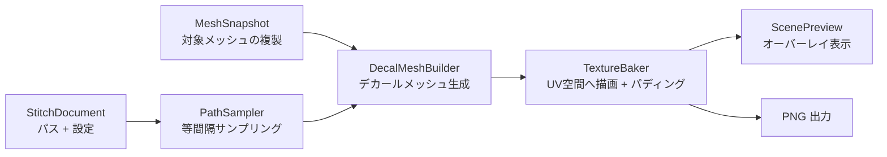
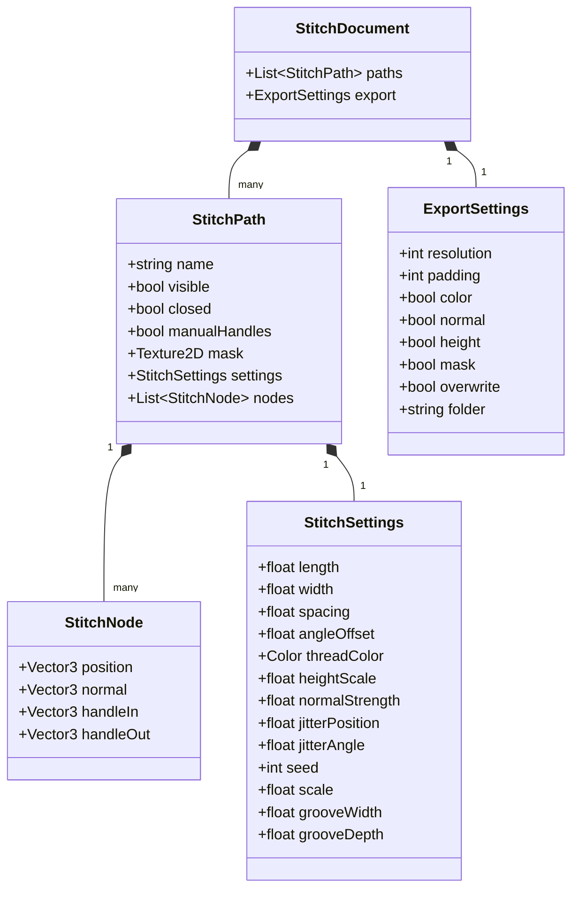

# StitchMaker 要件定義・設計書

**対象環境**: Unity 2022.3.22f1 / Unity 6（エディタ拡張のみ。ランタイムコードなし）  
**対象用途**: 靴・衣服などアバター衣装のテクスチャリングにおける、ステッチ（縫い目）専用作成ツール  
**作成日**: 2026-10-13  
**バージョン**: 0.2.0（0.1.0 からの変更点は [付録A](#付録a-010-からの変更点)）

---

## 1. 概要

### 1.1 背景
2D ペイントや UV 展開図上でステッチを描くと、次の問題が起きる。

- UV シームでステッチが分断される・歪む。
- テクセル密度の偏りで、ステッチのサイズと間隔が不揃いになる。
- 曲線に沿った配置と微調整に時間がかかる。

StitchMaker は、シーンビューでメッシュ表面にパスを置き、**メートル単位**でステッチを設定し、プレビューを見ながらテクスチャ（Color / Normal / Height / Mask）を出力する。

### 1.2 達成目標
1. **3D パス編集**: メッシュ表面のクリック・ドラッグだけで滑らかな曲線を作れる。
2. **UV 非依存**: サイズ・間隔は実寸で指定し、UV 密度・UV シームの影響を受けない。
3. **即時プレビュー**: パスや設定の変更が 100ms 以内にシーンビューへ反映される。
4. **非破壊**: 対象のメッシュ・マテリアル・シーンを一切変更しない。成果物は新規 PNG のみ。

### 1.3 v1 でやらないこと（スコープ外）
KISS 原則に従い、以下は実装しない。必要になった時点で個別に検討する。

| 項目 | 理由・代替 |
| :--- | :--- |
| Metallic / Roughness / シェーダー別パッキング出力 | Mask 出力があれば各シェーダー側で合成できる |
| TGA / 16bit PNG 出力 | PNG 8bit のみ |
| ゲームビューでのプレビュー、元マテリアルと合成した最終ルック表示 | シーンビューのオーバーレイのみ。最終ルックは出力テクスチャを割り当てて確認 |
| ノードの複数選択 | 単一選択のみ |
| プリセットの複製・名称変更・インポート/エクスポート | プリセットは単純なファイルなので、フォルダを開いてファイル操作で代替 |
| UV1 以降・UDIM・0–1 範囲外の UV | UV0 の 0–1 範囲のみ |
| ポーズ変更へのパス自動追従 | 編集中はポーズを固定する（変更時は手動で再スナップショット） |
| BVH・ComputeShader・マルチスレッド | 単純な均一グリッドと通常のラスタライズで足りる（§9） |

---

## 2. 設計方針

実装全体を次の 5 つの決定で単純化する。

1. **エディタ専用・単一アセンブリ**。ランタイムコードを持たないため、アバターのビルドに何も混入しない。
2. **編集対象は 1 つの `StitchDocument`（ScriptableObject）**。ウィンドウがメモリ上のインスタンスを保持し、`.asset` はそのスナップショット（保存＝コピー書き出し、読込＝コピー読み込み）。Undo は `Undo.RecordObject(document)` の 1 経路だけになる。
3. **パスは設定値を自分で持つ。プリセットは「値のテンプレート」**。プリセットを適用すると値がパスへコピーされ、以後は参照しない。ID による参照解決や、プリセット変更の波及は存在しない。
4. **投影は「デカールメッシュを UV 空間に 1 回描く」だけ**。ステッチごとに近傍三角形を集め、ステッチ基準の座標を頂点に持たせた一時メッシュを CPU で作り、UV を画面座標として描画する。シーム跨ぎと UV 密度非依存はこの方式から自動的に得られる。
5. **プレビューと出力は同じパイプライン・同じ解像度**。プレビュー用の別実装を持たない（WYSIWYG）。

### 2.1 処理パイプライン



ドキュメントまたはスナップショットが変わるたびに B→C→D を全パスについて再実行する。v1 では差分更新を行わない（§9.1 の目標を満たせない場合のみ、パス単位の再構築を導入する）。

### 2.2 座標系
すべての幾何データは **メッシュ空間** で扱う。

- 定義: 対象 Renderer の Transform から位置と回転だけを取り除いた空間（スケール適用済み）。
- `meshToWorld = Matrix4x4.TRS(t.position, t.rotation, Vector3.one)`
- 1 単位 = ワールドの 1m なので、ステッチの実寸指定がそのまま使える。
- オブジェクトを移動・回転してもパスは追従する。スケール・ポーズ・ブレンドシェイプを変えた場合は再スナップショットが必要。

---

## 3. フォルダ・ファイル構成

```
Assets/dennokoworks/StitchMaker/
├─ Docs/Impl/                       設計ドキュメント
├─ Docs/Tools/generate_masks.py     同梱マスクの生成スクリプト（numpy + Pillow）
├─ Masks/                           同梱マスク 18 種（§4.5）
├─ Presets/                         同梱プリセット 20 種（§4.5）
├─ version.json                     ローカルのバージョン（§8.5）
└─ Editor/
   ├─ dennokoworks.StitchMaker.Editor.asmdef   （Editor プラットフォームのみ）
   ├─ DennokoUIFont.cs              標準フォント（メイリオ SDF）の適用（デザインスキルの共通ファイル）
   ├─ DennokoVersionChecker.cs      GitHub 上の version.json の取得・比較（同上）
   ├─ StitchMakerVersion.cs         バージョンチェックの設定・取得間隔の制御
   ├─ Data/
   │  ├─ StitchSettings.cs          ステッチの数値設定（JSON 化可能）
   │  ├─ StitchPath.cs              StitchNode / StitchPath
   │  ├─ StitchDocument.cs          ScriptableObject（パス一覧 + 出力設定）
   │  ├─ PresetStore.cs             プリセットのファイル入出力（ユーザー / 同梱）
   │  └─ MaskImportSettings.cs      同梱マスクのインポート設定を固定（sRGB OFF・非圧縮）
   ├─ Core/
   │  ├─ MeshSnapshot.cs            対象メッシュの複製・レイキャスト・近傍検索
   │  ├─ PathSampler.cs             曲線評価・等間隔サンプリング
   │  ├─ DecalMeshBuilder.cs        デカールメッシュ生成
   │  ├─ TextureBaker.cs            RenderTexture 描画・パディング・PNG 出力
   │  └─ PresetThumbnailRenderer.cs プリセット一覧のサムネイル描画（§8.1.1）
   ├─ UI/
   │  ├─ StitchMakerWindow.cs       EditorWindow（状態保持・UI のバインド・再構築の起点）
   │  ├─ StitchMakerWindow.uxml     ウィンドウの構造
   │  ├─ DennokoTheme.uss           dennokoworks テーマ（デザインスキルの共通ファイル）
   │  ├─ StitchMaker.uss            ツール固有のスタイル
   │  ├─ Loc.cs                     日本語 / 英語のローカライズ
   │  ├─ PresetPicker.cs            プリセット一覧ポップアップ・サムネイルのキャッシュ（§8.1.1）
   │  ├─ ScenePathEditor.cs         シーンビューのパス編集
   │  └─ ScenePreview.cs            シーンビューのプレビュー描画
   └─ Shaders/
      ├─ StitchBake.shader          Pass 0: Decal / 1: IslandMask / 2: Dilate / 3: Thumbnail
      └─ StitchPreview.shader       オーバーレイ表示
```

- 名前空間は `Dennokoworks.StitchMaker`。
- 依存方向は `UI → Core → Data` の一方向。`Core` と `Data` は `EditorWindow` / `SceneView` を参照しない。
- ウィンドウの UI は UI Toolkit（UXML = 構造 / USS = スタイル / C# = ロジック）で実装し、dennokoworks デザインスキルの規約に従う（§8.4）。シーンビューの操作のみ IMGUI（`Handles`）を使う。
- シェーダーは `Hidden/dennokoworks/StitchMaker/Bake`・`.../Preview` として `Shader.Find` で取得する。即時描画（`Graphics.DrawMeshNow`）のみ使うため、Built-in / URP / HDRP のいずれでも同じシェーダーで動く。
- プロジェクト内に生成するファイルは、ツール本体の更新で消えないよう `Assets/dennokoworks/StitchMakerData/` 以下に置く（§4.4）。

---

## 4. データ設計



### 4.1 StitchSettings（`[Serializable] class`）
数値だけを持つ。`JsonUtility` でそのままプリセットファイルになる。
描画（`PathSampler` / `DecalMeshBuilder` / サムネイル）は `length`・`width`・`spacing`・`jitterPosition`・`grooveWidth` に `scale` を掛けた `ScaledLength` などの読み取り専用プロパティを使う。

| フィールド | 単位 / 範囲 | 既定値 | 内容 |
| :--- | :--- | :--- | :--- |
| `scale` | 倍率（UI は 0.25–4、下限 0.01） | 1 | `length`・`width`・`spacing`・`jitterPosition`・`grooveWidth` にまとめて掛ける倍率。比率を保ったまま大きさを変える。UI の各スライダーは倍率を掛ける前の値を表示する |
| `length` | m（UI は mm、0.5–20） | 0.003 | ステッチ 1 目の長さ（パス方向 = マスクの U 方向） |
| `width` | m（UI は mm、0.1–10） | 0.0008 | ステッチの幅（マスクの V 方向） |
| `spacing` | m（UI は mm、0.5–30） | 0.004 | 隣り合うステッチの中心間距離 |
| `angleOffset` | 度、-180–180 | 0 | パス接線に対する回転（法線軸まわり） |
| `threadColor` | Color | 白 | 糸の色 |
| `heightScale` | 0–1 | 1 | Height 出力値 = マスク値 × `heightScale` |
| `normalStrength` | 0–2 | 0.5 | 凹凸の強さ。1 のとき「糸の盛り上がり = ステッチ幅」相当 |
| `jitterPosition` | m（UI は mm、0–2） | 0 | 位置の乱数ゆらぎ（接線・従法線方向）。0 で無効 |
| `jitterAngle` | 度、0–30 | 0 | 角度の乱数ゆらぎ。0 で無効 |
| `seed` | int | 0 | ゆらぎの乱数シード（結果を決定的にする） |
| `grooveWidth` | m（UI は mm、0–10） | 0 | パスに沿って布地を凹ませる溝の幅。0 で溝なし（§7.5） |
| `grooveDepth` | 0–2 | 0.5 | 溝の壁の傾き。0 で溝なし。Normal にだけ出る |

### 4.2 StitchNode / StitchPath（`[Serializable] class`）
- `StitchNode.position` / `normal`: メッシュ空間。`normal` はレイキャストで得た補間法線。
- `StitchNode.handleIn` / `handleOut`: ノード位置からのオフセット（メッシュ空間）。`StitchPath.manualHandles` が `true` のときだけ使う。
- `StitchPath.mask`: 白黒マスク（濃淡 = 高さ）。必ずプロジェクト内の `Texture2D` アセットを参照する。
- `StitchPath.visible`: `false` のパスはプレビューにも出力にも含めない。
- 接線は保存しない（曲線から都度求める）。
- `StitchPath.mirrorAxis`（`None` / `X` / `Y` / `Z`、既定 `None`）: メッシュ空間でその軸の座標が 0 の平面を対称面として、反対側にも同じステッチを描く。
- `StitchPath.mirrorSnapRadius`（m、既定 0.03）: 鏡映した制御点を反対側の表面へ吸着させる探索半径。UI は mm で表示する。
- ミラーの 2 項目はパスの属性であり、`StitchSettings` には入れない（プリセットを適用しても変わらない）。
- 「+ パスを追加」でパスを追加すると、選択中のパスの `settings`（複製）と `mask` を引き継ぐ。同じステッチを複数箇所に置く用途のため。形状（ノード・`closed`・`manualHandles`）とミラーの 2 項目は引き継がない。パス未選択時（およびパス未選択のままシーンビューをクリックして自動作成したとき）は既定値と同梱の Straight マスクになる。

### 4.3 StitchDocument（`ScriptableObject`）
- 編集中の実体はメモリ上のインスタンス（`HideFlags.DontSave`）。ウィンドウの `[SerializeField]` で保持するため、ドメインリロードとプレイモード切替をまたいで残る。エディタ終了・ウィンドウを閉じると失われる。
- **保存**: `Instantiate(document)` を `AssetDatabase.CreateAsset`。既存アセットへの上書きは `EditorUtility.CopySerialized` で GUID を維持する。
- **読込**: `Instantiate(asset)` を編集対象にする。アセット自体は編集しない。
- 未保存の変更がある状態で「新規」「読込」を行う場合は確認ダイアログを出す（ウィンドウが `bool dirty` を保持）。
- 対象 Renderer はシーン参照のためドキュメントには保存しない。読込後にユーザーが指定する。
- `ExportSettings` の既定値: `resolution = 2048`、`padding = 4`、全マップ出力 ON、`overwrite = false`、`folder` は対象マテリアルのメインテクスチャの親フォルダ配下の `StitchMakerTexture`（メインテクスチャ未設定または Assets 外の場合はフォールバックとして `"Assets/dennokoworks/StitchMakerData/Textures"`）。

### 4.4 プリセット（`PresetStore`）
- 保存先: `%APPDATA%/dennokoworks/StitchMaker/Presets/`（`Environment.SpecialFolder.ApplicationData`）。Unity プロジェクトをまたいで共有される。
- 1 プリセット = 同名の 2 ファイル。**ファイル名がプリセット名**であり、ID は持たない。
  - `{name}.json` … `StitchSettings` の `JsonUtility` 出力
  - `{name}.png` … マスク画像
- **保存**: パスの `settings` を JSON 化し、`mask` を RenderTexture 経由で PNG 化して書き出す（非 Readable・圧縮テクスチャでも同じ経路で扱える）。同名が存在する場合は上書き確認。
- **適用**: JSON を読み、パスの `settings` に値をコピーする（`StitchSettings.OverwriteFromPreset`）。JSON に無い項目（同梱プリセットや旧形式の `scale`・溝など）が適用前の値のまま残らないよう、コピー前に全項目を既定値へ戻す。マスク PNG は `Assets/dennokoworks/StitchMakerData/Masks/{name}_{内容ハッシュ先頭8桁}.png` へコピーして取り込み、その `Texture2D` をパスの `mask` に設定する。同じ内容のファイルが既にあれば再利用する。
- **削除**: 2 ファイルを削除する。適用済みのパスには影響しない。
- **読み込み（サムネイル用）**: `Load` / `LoadBuiltIn` は設定とマスクを読むだけで、パスへの適用やプロジェクトへの取り込みはしない。ユーザープリセットのマスク PNG はメモリ上の一時テクスチャとして読む。
- 取り込んだマスクのインポート設定: sRGB OFF、圧縮なし、Wrap = Clamp、ミップマップ ON。

### 4.5 同梱マスク・同梱プリセット
- **同梱プリセット**はツール本体の `Presets/{name}.json`。`StitchSettings` の JSON に `category`（メニューの分類）・`order`（表示順）・`mask`（`Masks/` 内のファイル名）を加えた形式で、「適用…」の一覧にカテゴリごとの見出しを付けて並ぶ（§8.1.1）。適用時の動作はユーザープリセットと同じ（値のコピー）で、削除・上書きはできない。
- **同梱マスク**は `Docs/Tools/generate_masks.py` で生成する。64 px/mm（`Twisted` のみ 128 px/mm）で描いており、プリセットの `length : width` は画像の横 : 縦と同じ比率にしてある。大きさを変えるときは `length`・`width`・`spacing` を同じ倍率で変える。
- `normalStrength` は「盛り上がり ÷ `width`」なので、幅の広いマスク（Double や Cross など）ほど小さい値になる。

| カテゴリ | プリセット | マスク | 長さ × 幅 / 間隔 (mm) | 備考 |
| :--- | :--- | :--- | :--- | :--- |
| 基本 | Straight | Straight | 3.0 × 0.75 / 3.6 | 新規パスの既定マスク（パス未選択で追加したとき） |
| 基本 | Double | Double | 3.0 × 3.5 / 3.6 | 2 本の間隔は約 2.75mm |
| 基本 | DoubleNarrow | DoubleNarrow | 3.0 × 1.75 / 3.6 | 2 本の間隔は 1.0mm（糸の隙間は糸 1 本分） |
| 基本 | Triple | Triple | 3.0 × 4.0 / 3.6 | |
| 基本 | TripleNarrow | TripleNarrow | 3.0 × 2.75 / 3.6 | 隣の線との間隔は 1.0mm |
| 基本 | Thick | Thick | 5.0 × 1.5 / 6.5 | 革用の太糸 |
| 糸の質感 | Twisted | Twisted | 3.0 × 0.75 / 3.6 | 撚りの溝あり |
| 糸の質感 | FlatWaxed | FlatWaxed | 4.0 × 1.25 / 5.0 | 上面が平らな平紐 |
| かがり・端処理 | Zigzag | Zigzag | 3.0 × 3.0 / 3.0 | タイル連続（間隔 = 長さ） |
| かがり・端処理 | Overlock | Overlock | 1.5 × 4.5 / 1.5 | タイル連続 |
| かがり・端処理 | Blanket | Blanket | 4.0 × 5.0 / 4.0 | タイル連続 |
| かがり・端処理 | Whip | Whip | 3.0 × 5.0 / 3.0 | |
| 装飾 | Cross | Cross | 3.5 × 3.5 / 4.0 | |
| 装飾 | DoubleCross | DoubleCross | 4.5 × 4.5 / 5.5 | 米字型 |
| 装飾 | Chain | Chain | 3.6 × 1.8 / 2.66 | 間隔 < 長さで輪が噛み合う |
| 装飾 | Baseball | Baseball | 3.0 × 5.0 / 3.0 | 合わせ目の上にパスを置く |
| 装飾 | Herringbone | Herringbone | 5.0 × 4.0 / 3.4 | 間隔 = 長さ × 0.68 で交点が揃う |
| 特殊 | Rough_Handsewn | Rough | 4.0 × 1.5 / 5.0 | 位置・角度のゆらぎ付き |
| 特殊 | Frankenstein | Rough | 6.0 × 2.25 / 4.0 | 角度 90° で合わせ目をまたぐ |
| 特殊 | Channel | Straight | 3.0 × 0.75 / 3.4 | 幅 2.6mm・深さ 0.8 の溝に糸が沈む（靴のコバ・底周りの溝縫い）。溝が目立つよう実物よりやや広い。高さ 0.5 |

- タイル連続のマスクは「間隔 = 長さ」のときに隣と繋がる。片側だけに糸が寄るマスク（Overlock・Blanket）の向きは、角度を 180° にすると反転する。
- **未対応**（現在の実装ではマスクと数値だけでは表現できない）:
  - 針穴付き・空のパンチ穴 … マスクは 0 が布地の高さで、布地より低い「谷」を表せない（パスに沿って連続した溝だけは `grooveWidth` で描ける）。
  - パッカリング … マスク値がそのまま糸の被覆率（Color の A）になるため、糸の周囲の布のしわだけを凹凸として出せない。
  - ほつれ・たるみ … 1 本のパスは同じマスクを繰り返すため、一部のステッチだけ形を変えられない。

---

## 5. クラス設計

各クラスの責務と公開メンバーを示す。ここに無い補助メソッドは `private` とする。

### 5.1 Data

```csharp
[Serializable] public class StitchSettings { /* §4.1 のフィールド */ public StitchSettings Clone(); }
[Serializable] public class StitchNode     { /* §4.2 のフィールド */ }
[Serializable] public class StitchPath     { /* §4.2 のフィールド */ }
[Serializable] public class ExportSettings { /* §4.3 のフィールド */ }

public class StitchDocument : ScriptableObject
{
    public List<StitchPath> paths = new();
    public ExportSettings export = new();
}

public static class PresetStore
{
    public static string Directory { get; }                 // 無ければ作成
    public static string[] GetNames();                      // *.json のファイル名一覧
    public static void Save(string name, StitchSettings settings, Texture2D mask);
    public static void Apply(string name, StitchPath path); // settings と mask を上書き
    public static void Delete(string name);
}
```

### 5.2 Core

```csharp
// 対象メッシュのメッシュ空間での複製。生成後は不変。
public sealed class MeshSnapshot : IDisposable
{
    public MeshSnapshot(Renderer renderer, int materialIndex);
    public Mesh Mesh { get; }                    // プレビュー描画・アイランドマスク描画用
    public Vector3[] Vertices, Normals;          // CPU 参照用キャッシュ
    public Vector4[] Tangents;
    public Vector2[] Uvs;
    public int[] Triangles;                      // materialIndex のサブメッシュのみ
    public bool Raycast(Ray meshSpaceRay, out Vector3 position, out Vector3 normal);
    public void QueryTriangles(Bounds bounds, List<int> results);   // 三角形インデックス
}

public struct StitchSample { public Vector3 position, tangent, normal; }

public static class PathSampler
{
    // ノード i → i+1 の 3 次ベジェ制御点（自動 / 手動ハンドルを吸収）
    public static void GetSegment(StitchPath path, int index,
        out Vector3 p0, out Vector3 p1, out Vector3 p2, out Vector3 p3);
    // 表示・当たり判定用の折れ線（1 セグメント 16 分割）
    public static void BuildPolyline(StitchPath path, List<Vector3> points);
    // ステッチ配置（等間隔・ジッター・角度オフセット適用済み）
    public static void Sample(StitchPath path, List<StitchSample> results);
    // 溝の区切り（step 間隔、ジッター・角度オフセットなし）
    public static void SampleGroove(StitchPath path, float step, List<StitchSample> results);
    // manualHandles を ON にした時に自動ハンドルをノードへ書き込む
    public static void BakeAutoHandles(StitchPath path);
}

public static class DecalMeshBuilder
{
    // 1 パス分のデカールメッシュを mesh に書き込む（mesh は呼び出し側が再利用）
    public static void Build(MeshSnapshot snapshot, StitchSettings settings,
        List<StitchSample> samples, Mesh mesh);
    // 各サンプルに length × width の四角形を貼る（溝用）
    public static void Build(MeshSnapshot snapshot, float length, float width,
        List<StitchSample> samples, Mesh mesh);
}

public sealed class TextureBaker : IDisposable
{
    public RenderTexture Color  { get; }   // ARGB32 sRGB   : RGB = 糸色, A = 被覆率
    public RenderTexture Normal { get; }   // ARGB32 Linear : 接空間法線
    public RenderTexture Height { get; }   // R8 Linear
    public void Render(MeshSnapshot snapshot, StitchDocument document);  // サンプリング〜パディングまで
    public void Export(ExportSettings export, string baseName);          // PNG 書き出し + インポート設定
}
```

### 5.3 UI

```csharp
public class StitchMakerWindow : EditorWindow
{
    // [SerializeField] で保持する状態
    //   StitchDocument document; Renderer target; int materialIndex;
    //   int selectedPath, selectedNode; bool editMode, previewOn, dirty; PreviewMode previewMode;
    // 非シリアライズ（OnEnable / 必要時に再生成）
    //   MeshSnapshot snapshot; TextureBaker baker; bool needsRebuild;

    [MenuItem("dennokoworks/StitchMaker")] static void Open();
    void OnEnable();    // SceneView.duringSceneGui / Undo.undoRedoPerformed を購読
    void OnDisable();   // 購読解除、Tools.hidden を戻す、snapshot / baker を Dispose
    void OnGUI();       // §8 の UI。値変更時に Undo.RecordObject → needsRebuild = true
    void OnSceneGUI(SceneView view);  // ScenePathEditor → 必要なら再構築 → ScenePreview
}

public static class ScenePathEditor
{
    // 入力処理とパスのギズモ描画。ドキュメントを変更したら true を返す。
    public static bool OnSceneGUI(StitchDocument document, MeshSnapshot snapshot,
        Matrix4x4 meshToWorld, ref int selectedPath, ref int selectedNode);
}

public enum PreviewMode { Combined, Normal, Height }

public static class ScenePreview
{
    public static void Draw(MeshSnapshot snapshot, TextureBaker baker,
        Matrix4x4 meshToWorld, PreviewMode mode);
}
```

再構築は `EditorApplication.update` で `needsRebuild` を見て `baker.Render(snapshot, document)` を 1 回呼ぶだけとする（シーンビューの描画中に RenderTarget を切り替えないため、`OnSceneGUI` の中では行わない）。`needsRebuild` を立てる契機は、ドキュメントの変更・Undo/Redo・スナップショット再生成・解像度/パディング変更の 4 つ。

---

## 6. シーンビュー操作

### 6.1 操作一覧
編集モード ON かつ対象 Renderer 指定済みのときだけ入力を受け付ける。編集モード中は `Tools.hidden = true` とし、`HandleUtility.AddDefaultControl` でシーンの選択操作を抑止する。

| 操作 | 動作 |
| :--- | :--- |
| メッシュ上を左クリック | 選択中パスの末尾にノードを追加（中間ノード選択中はその直後に挿入） |
| パスの線上を左クリック | そのセグメントにノードを挿入（そのままドラッグで移動できる） |
| ノードを左クリック | ノードだけを選択 |
| Shift + ノードを左クリック | ノードを選択に加える。選択済みなら外す |
| 空いた場所（ノード・ハンドル・線以外）を左ドラッグ | 矩形選択（こちらを向いたノードのみ）。Shift 併用で今の選択に加える |
| メッシュ外を左クリック | 選択を解除 |
| ノードを左ドラッグ | メッシュ表面に沿って移動（位置と法線を更新）。選択中のノードを掴むと選択ノードをまとめて移動 |
| ノードを右クリック | ノードを削除 |
| ハンドルを左ドラッグ（`manualHandles` ON、選択ノードのみ表示） | ハンドルをメッシュ表面に沿って移動。反対側は点対称に追従 |
| Shift + ハンドルを左ドラッグ | 反対側を追従させず独立に動かす（角を作る） |

- 当たり判定の優先順位は **ノード（ハンドル含む）＞ パスの線 ＞ メッシュ**。ノードは画面上 10px、線は 6px 以内。
- 右クリックはノード上で `MouseDown` した場合のみ `Event.Use()` する。それ以外はシーンビュー標準の視点操作に渡す。
- 閉じたパスへの切り替え、パスの追加・削除・選択はウィンドウ側で行う。キー修飾による補助操作は Shift（ハンドル独立、選択の追加・解除）のみ。
- 空いた場所で押した場合は `MouseUp` まで判定を保留し、4px 以上動いたら矩形選択、動かずに離したらクリック（ノード追加 / 選択解除）とする。そのため、メッシュ上の空いた場所からのドラッグではノードを追加しない。
- 複数選択は `ScenePathEditor` が保持し、主選択（ウィンドウの `selectedNode`。ハンドル表示と追加位置の基準）を必ず含む。選択中のパス・ノード数・主選択がウィンドウ側や Undo で変わったら、主選択だけに戻す。
- 複数移動では、掴んだノードをマウス位置へ移し、ほかの選択ノードは移動開始時の位置に同じ移動量を加えてから `MeshSnapshot.TrySnapToSurface`（半径 = 移動量、最小 1cm）で表面へ吸着させる。吸着できなければ移動量を加えた位置と元の法線を使う。ハンドルは向きを変えずに追従する。
- パスが 1 本も無い状態でメッシュをクリックした場合は、パスを自動作成してから追加する。

### 6.2 メッシュ表面への吸着
- マウスレイをメッシュ空間へ変換し、`MeshSnapshot.Raycast` で最近傍の交点を得る。
- 実装は全三角形への Möller–Trumbore 総当たり（表面のみ、裏面は無視）。Collider や Unity の内部 API には依存しない。10 万三角形で数 ms を想定し、§9.1 の目標を満たせない場合のみグリッドを使った高速化を検討する。
- 法線は交点の重心座標で頂点法線を補間した値を使う。
- 交点が無い場合（メッシュ外をドラッグ）は直前の位置を保つ。

### 6.3 表示
- 選択中パスは不透明、それ以外は半透明の折れ線（`Handles.DrawAAPolyLine`）。ギズモは常に最前面に描く。
- ノードは点、選択ノードは強調色（主選択は少し大きく描く）。矩形選択中は範囲を半透明の矩形で示す。法線がカメラの反対を向くノード（裏側）は薄く表示し、当たり判定から除外する。

### 6.4 Undo / Redo
- ドキュメントを変更する操作はすべて、変更前に `Undo.RecordObject(document, 操作名)` を呼ぶ。ドラッグは `MouseDown` 時に 1 回だけ記録する。
- `Undo.undoRedoPerformed` で `needsRebuild = true` とし、ウィンドウとシーンビューを再描画する。選択インデックスは範囲外になっていれば丸める。

---

## 7. 曲線・投影アルゴリズム

### 7.1 曲線
曲線の評価は **3 次ベジェの 1 経路のみ** とする。自動補間は「ハンドルを自動計算したベジェ」として扱う。

- **自動ハンドル**（`manualHandles = false`）: ノード `i` の方向 `d = normalize(P[i+1] − P[i−1])` を使い、
  - `handleOut = d × |P[i+1] − P[i]| / 3`
  - `handleIn = −d × |P[i] − P[i−1]| / 3`
  - 開いたパスの端点は隣接ノードへの方向を使う。閉じたパスはインデックスを循環させる。
  - 隣接区間の長さで正規化するため、ノード間隔が不揃いでも膨らみすぎない。
- **手動ハンドル**（`manualHandles = true`）: ノードに保存された値を使う。ON にした瞬間に `BakeAutoHandles` で現在の自動値を書き込むため、見た目は変わらない。ON の間に追加したノードにも追加時点の自動値を書き込む。

### 7.2 ステッチのサンプリング（`PathSampler.Sample`）
1. 各セグメントを 16 分割して折れ線化し、累積距離を求める。全長を `L` とする。
2. ステッチ数 `n` と実効間隔 `s` を決める。
   - 開いたパス: `n = floor(L / spacing)`、`s = spacing`。両端の余りを等分し、最初のステッチ中心を `(L − (n−1)·s) / 2` に置く。
   - 閉じたパス: `n = round(L / spacing)`、`s = L / n`（継ぎ目が出ないよう間隔を微調整）。
3. 各ステッチ中心について折れ線上の位置と接線 `T` を求める。法線 `N` は両端ノードの法線を補間し、`T` と直交化する。
4. `seed` とパスのインデックスから生成した乱数でジッターを加え、`T` を `N` 軸まわりに `angleOffset`（＋角度ジッター）だけ回転する。

> サンプル点は曲線上にあり、メッシュ表面から僅かに浮く・沈むことがある。この誤差は §7.3 の深度許容で吸収する。曲率の大きい箇所ではノードを密に置く運用とする。

#### ミラー（`mirrorAxis != None`）
詳細な背景は [`mirror_specification.md`](mirror_specification.md) を参照。`Sample` に `MeshSnapshot` を渡すと、元パスのサンプルに続けてミラー側のサンプルを同じリストへ追加する。

1. 各ノードの位置・法線・ハンドルを対称軸の成分だけ符号反転する。
2. `MeshSnapshot.TrySnapToSurface` で反対側の表面へ吸着させる。対象は面法線が反転後の法線と同じ側を向く三角形（内積 > 0.2）のみ。法線方向のレイキャスト（始点は法線側へ半径ぶん離した点、長さは半径の 2 倍）を優先し、外れたら三角形上の最近傍点を使う。半径内に無ければ反転しただけの値を使う。吸着で法線が変わった分だけハンドルを回転させる。
3. 吸着後のノード列を上記 1〜4 と同じ手順で等間隔に刻む（サンプルを反転するのではなく刻み直すので、左右で膨らみが違っても間隔が保たれる）。鏡像になるよう、角度（`angleOffset` と角度ジッター）と幅方向の位置ジッターは符号を反転する。乱数列は元パスと同じものを使う。
4. 曲線上の点の対称軸成分の絶対値が `width × 0.25` 未満のミラー側サンプルは捨てる（対称面上での二重焼き防止）。

「独立パスとして実体化」は手順 1〜2 の結果を新しい `StitchPath`（`PathSampler.CreateMirroredPath`、設定は複製し `angleOffset` の符号を反転）として末尾に追加し、元パスの `mirrorAxis` を `None` に戻す。シーンビューではミラー側の折れ線（`BuildMirroredPolyline`）を半透明で描くだけで、ノードは表示も編集もしない。

### 7.3 デカールメッシュ生成（`DecalMeshBuilder.Build`）
ステッチ 1 個につき、次の手順で三角形を出力する。`B = cross(N, T)`、深度許容 `D = max(length, width)` とする。

1. 中心 `C`、半径 `0.5·sqrt(length² + width²)` を含む AABB で `MeshSnapshot.QueryTriangles` を呼び、候補三角形を得る。
2. 面法線と `N` の内積が 0 以下の三角形（裏向き・反対側の面）を捨てる。
3. 残った三角形の各頂点 `P` について、次の頂点を出力する。

| 属性 | 値 | 用途 |
| :--- | :--- | :--- |
| `POSITION` | `(uv.x, uv.y, 0)` | UV 空間での描画位置 |
| `TEXCOORD0` (float3) | `( dot(P−C, T)/length + 0.5, dot(P−C, B)/width + 0.5, dot(P−C, N)/D )` | マスクの UV と正規化深度 |
| `TEXCOORD1` (float3) | `T` をその頂点の接空間（接線・従法線・法線）で表したもの | 法線マップ計算 |
| `TEXCOORD2` (float3) | `B` を同じ接空間で表したもの | 同上 |

ステッチ座標は位置の一次式なので、三角形内の線形補間で厳密に求まる。各三角形は自分の UV 位置に描かれるため、**シームをまたぐステッチも両側のアイランドへ自動的に分割して描かれる**。また座標はメートル基準なので、UV 密度に関係なく同じ実寸になる。

`QueryTriangles` は均一グリッドで実装する（セル辺 = メッシュ AABB の最長辺 / 64。各セルに AABB が重なる三角形のインデックスを保持）。

### 7.4 ベイクシェーダー（`StitchBake.shader`）

**Pass 0: Decal** — MRT 3 枚（Color / Normal / Height）＋深度。`Cull Off`、`ZTest LEqual`、`ZWrite On`。パスごとにマテリアルプロパティ（`_MaskTex`、`_Color`、`_HeightScale`、`_NormalScale`）を設定して 1 回描画する。

```
(s, t, d) = TEXCOORD0
s, t が [0,1] の外、または |d| > 1 なら破棄
m      = マスク(s, t).r
ms, mt = マスクの s / t 方向の中心差分
Color  = (糸色.rgb, saturate(m × 20))
Normal = normalize((0,0,1) − k·(width/length)·ms·TEXCOORD1 − k·mt·TEXCOORD2)   // k = normalStrength
Height = m × heightScale
深度   = m が大きいほど手前
```

- **重なりは「マスク値の高い方が勝つ」**。深度にマスク値を書くことで、3 枚のターゲットが常に同じステッチの値で揃う（クロスステッチや急カーブでの重なりが破綻しない）。
- `m = 0` の画素も破棄せず、糸色・被覆率 0・平坦な法線を書く。これによりステッチ周囲の RGB が糸色で埋まり、バイリニア補間時の黒フチが出ない。ただし溝（Pass 4）の画素は `m = 0` より僅かに手前なので、ステッチの余白で上書きされない。
- 法線はステッチ基準の勾配から直接求めるため、UV 密度や UV の回転・反転に依存しない。出力は Unity 標準（OpenGL、+Y）とする。
- クリア値: Color = (0,0,0,0)、Normal = (0.5,0.5,1,1)、Height = 0。

**Pass 1: IslandMask** — `MeshSnapshot.Mesh` を UV 空間に描き、UV アイランド内を 1 にする（R8）。

**Pass 2: Dilate** — 有効マスクが 0 の画素について、8 近傍のうち有効な画素の平均を書く。Color / Normal / Height とアイランドマスク自身に同じパスを `padding` 回適用する（1 回で 1px 拡張）。シーム上のステッチがアイランド境界で途切れてミップマップで滲むのを防ぐ。

**Pass 3: Thumbnail** — プリセット一覧のサムネイル合成（§8.1.1）。

**Pass 4: Groove** — 溝（§7.5）。頂点形式は Pass 0 と同じ。

```
(s, t, d) = TEXCOORD0（範囲外は破棄）
y      = |2t − 1|                       // 0 = 溝の中心、1 = 溝の縁
u      = saturate((y − 0.4) / 0.6)      // 中央 40% は平らな底、外側が壁
slope  = grooveDepth · 6u(1−u) / 0.6 · sign(t − 0.5)   // smoothstep の傾き
Color  = (糸色.rgb, 0)
Normal = normalize((0,0,1) − slope·TEXCOORD2)
Height = 0
深度   = マスク値 0.001 相当
```

### 7.5 溝（`grooveWidth > 0` かつ `grooveDepth > 0`）
靴のコバ周りなどの「溝の中に沈んだステッチ」を表すため、パスに沿って布地を凹ませる。マスクは 0 = 布地の高さで谷を表せないため、マスクとは別に描く。

1. パスごとに、ステッチより先に溝を描く。`PathSampler.SampleGroove` で `grooveWidth / 2` 間隔に区切り（ジッター・角度オフセットなし、ミラーは §7.2 と同じ）、各区切りに長さ `grooveWidth`・幅 `grooveWidth` の四角形を貼る。隣と半分ずつ重なるので、曲線でも途切れない。
2. Pass 4 で Normal だけを凹ませる。Color の A と Height は布地のまま（Height は 0 = 布地なので、布地より低い値を持てない）。
3. 続けて描くステッチの糸（`m > 0`）は溝より手前なので上に乗り、余白（`m = 0`）は溝を上書きしない。
4. 透過出力（§8.3）では、Normal のアルファを被覆率と「法線の傾き（`(255 − B) × 24`）」の大きい方にして、糸の無い溝の部分も残す。

---

## 8. UI

### 8.1 ウィンドウ構成
メニュー `Window > dennokoworks > StitchMaker`。上から 4 セクションの単一ウィンドウとする。

```
┌──────────────────────────────────────────────────────────┐
│ ▼ 対象                                                    │
│   Renderer:  [ Shoes (SkinnedMeshRenderer)    (◎) ] [クリア]│
│   Material:  [ 0: Mat_Shoes_Upper                    ▼ ] │
│   [ メッシュを再取得 ]                                    │
├──────────────────────────────────────────────────────────┤
│ ▼ パス                                                   │
│   [ 新規 ] [ 読込 ] [ 保存 ]                              │
│   [👁] Path 1                                      [ − ] │
│   [👁] Path 2  ← 選択中                            [ − ] │
│   [ + パスを追加 ]                                        │
│   [ 編集モード: ON ]   [x] 閉じる   [x] ベジェハンドル    │
├──────────────────────────────────────────────────────────┤
│ ▼ ステッチ設定（選択中のパス）                            │
│   プリセット: [ 適用… ▼ ] [ 保存… ] [ 削除… ] [ フォルダ ]│
│   名前:       [ Path 2                                 ] │
│   マスク:     [ Straight                            (◎) ]│
│   スケール:   [=====|==============]  1.00               │
│   長さ:       [=======|============]  3.0 mm             │
│   幅:         [==|=================]  0.8 mm             │
│   間隔:       [========|===========]  4.0 mm             │
│   角度:       [=========|==========]  0.0 °              │
│   糸の色:     [ ■                                      ] │
│   高さ:       [===================|]  1.00               │
│   凹凸の強さ: [=====|==============]  0.50               │
│   溝の幅:     [|===================]  0.0 mm             │
│   溝の深さ:   [=====|==============]  0.50               │
│   ゆらぎ(位置):[|===================]  0.0 mm            │
│   ゆらぎ(角度):[|===================]  0.0 °   Seed [ 0 ]│
├──────────────────────────────────────────────────────────┤
│ ▼ プレビュー・出力                                        │
│   [x] プレビュー   表示: [ Combined ▼ ]                   │
│   解像度: [ 2048 ▼ ]   パディング: [ 4 ] px              │
│   出力:   [x] Color  [x] Normal  [x] Height  [x] Mask    │
│   [ ] 上書き保存                                          │
│   出力先: [ Assets/.../StitchMakerTexture           ] [...] │
│   [ テクスチャを出力 ]                                    │
└──────────────────────────────────────────────────────────┘
```

- 対象の Material はスロット番号のポップアップで選ぶ。指定スロットのサブメッシュだけがスナップショット・レイキャスト・出力の対象になる。
- 対象 Renderer / Material の変更時と「メッシュを再取得」押下時に `MeshSnapshot` を作り直す。
- ステッチ設定はパス未選択時には表示しない。
- パス一覧の行を右クリックするとメニューを出す（`ContextualMenuManipulator`）。
  - **複製**: `StitchDocument.DuplicatePath` で形状・設定・マスク・ミラー設定ごと複製し、元の直後に挿入して選択する。名前は「元の名前 (Copy)」。
  - **ステッチ設定をコピー / 貼り付け**: `StitchSettings` とマスクをウィンドウの static フィールドへ写し、貼り付け先のパスへ複製して代入する（形状・ミラー設定・名前・表示は変えない）。何もコピーしていなければ貼り付けは無効表示。ドメインリロードで消える。
- パスセクションの「新規・読込・保存」はドキュメント全体の操作なので、パス単位の操作（「+ パスを追加」など）と誤認しないようパス一覧より上に置く。
- プリセットの「保存…」は名前入力、「適用…」はサムネイル付きの一覧（§8.1.1）、「削除…」は名前一覧のドロップダウン、「フォルダ」は保存先をエクスプローラーで開く。

#### 8.1.1 プリセット一覧（`PresetPicker` / `PresetThumbnailRenderer`）
- 「適用…」で `PopupWindowContent` のポップアップを開く。中身は UI Toolkit で、ウィンドウと同じテーマ（`.dennoko-root`・USS・フォント）を適用する。
- 同梱プリセットをカテゴリごとの見出しの下にタイル状に並べ、最後に「保存済み」としてユーザープリセットを並べる。タイルはサムネイル + プリセット名で、クリックすると適用して閉じる。ツールチップに長さ・幅・間隔を出す。
- サムネイルは 192 × 96 px（表示は 96 × 48）。実際のステッチを次の手順で描く。
  1. XY 平面上の直線パス（法線 +Z）を作り、`PathSampler.Sample` で配置を求める（角度オフセット・ゆらぎ・シードも反映される）。
  2. メッシュへの投影はせず、各ステッチを四角形 1 枚（四隅のステッチ座標 = (0,0)〜(1,1)）にして、Bake シェーダーの Decal パスで Color / Normal / Height に描く。
  3. 縮尺はプリセットごとに自動で決める。間隔 × 4 + 1 目分の外接矩形が横幅の 92% に、1 目分の高さが縦の 80% に収まる大きい方の縮尺を使い、端の目が切れないよう中心を置ける範囲に目を並べる。
  4. Pass 3（Thumbnail）で中間グレーの布地に Color を重ね、Normal を使って左上からの平行光で陰影を付ける（布地にも陰を付けるので溝が見える）。2 倍の解像度で描いてから縮小する。
  - 溝のあるプリセットは、ステッチの前に左端から右端までの四角形 1 枚で溝を描く。縦の縮尺は 1 目の高さと溝の幅の大きい方で決める。
- サムネイルはファイル（同梱は JSON のパス、ユーザーは名前）ごとにメモリ上へキャッシュし、更新時刻が変わったときだけ描き直す。ウィンドウを閉じたとき（`OnDisable`）に破棄する。

### 8.2 プレビュー（`ScenePreview`）
- シーンビューの Repaint 時に、`MeshSnapshot.Mesh` を `StitchPreview.shader` で対象メッシュの上に重ね描きする（`Graphics.DrawMeshNow`、`ZTest LEqual`、`Offset -1, -1`）。**対象の Renderer・マテリアルには触れない**ため、復元処理やシーンの Dirty 化が発生しない。
- スナップショットはポーズ適用済みのため、SkinnedMeshRenderer でもスキニングなしで表示位置が一致する。
- 表示モード:

| モード | 表示 |
| :--- | :--- |
| Combined | ステッチ部分だけを、糸色 × 簡易ライティング（カメラ方向のヘッドライト + 環境光）で半透明合成。糸の無い溝は、平らな面より暗くなる分を黒い陰として重ねる |
| Normal | メッシュ全体を灰色で不透明表示し、ステッチの法線だけでライティング |
| Height | メッシュ全体に Height をグレースケールで不透明表示 |

### 8.3 テクスチャ出力（`TextureBaker.Export`）

| ファイル | 内容 | インポート設定 |
| :--- | :--- | :--- |
| `{Renderer名}_Stitch_Color.png` | RGB = 糸色、A = 被覆率 | sRGB ON、Alpha Is Transparency ON |
| `{Renderer名}_Stitch_Normal.png` | 接空間法線（OpenGL、+Y） | Texture Type = Normal map（透過出力時は Default、sRGB OFF、Alpha Is Transparency ON） |
| `{Renderer名}_Stitch_Height.png` | グレースケール（0 = 地、255 = 最も高い） | sRGB OFF |
| `{Renderer名}_Stitch_Mask.png` | グレースケール（Color の A と同じ） | sRGB OFF |

- 出力先フォルダ:
  - 既定値は対象 Renderer の対象 Material に割り当てられているメインテクスチャ（`_MainTex` / `_BaseMap`）の配置フォルダ配下の `StitchMakerTexture/`（存在しない場合は自動作成）。
  - メインテクスチャ未設定またはプロジェクト外の場合はフォールバック先（`Assets/dennokoworks/StitchMakerData/Textures/`）を使用。
  - 出力先パスは UI で手動変更可能。
- 上書き保存（`overwrite`）:
  - 既定値は OFF。
  - **OFF の場合**: Unity 標準の重複回避ルールに準拠し、同名ファイルが存在するときはファイル名末尾に ` スペース＋連番`（例: `{Renderer名}_Stitch_Color 1.png`、`... 2.png`）を自動付与して保存。同時に出力される全マップで同じ連番が付与される。
  - **ON の場合**: 既存ファイルを上書き保存（再出力時に GUID が維持され、マテリアルへの割り当てが保持される）。
- ステッチ以外を透過（`transparent`）:
  - 既定値は OFF。画像編集ソフトで元のテクスチャへ重ねやすくするためのオプション。
  - **ON の場合**: Normal と Height を RGBA で書き出し、アルファに Color の A（被覆率）を入れる。Normal は溝（§7.5）も残るよう、法線が傾いている画素を傾きに応じて不透明にする。Height は Alpha Is Transparency を ON にする。
  - Texture Type = Normal map ではアルファが透過として扱われないため、透過出力時の Normal は Texture Type = Default（sRGB OFF、Alpha Is Transparency ON）で保存する。シェーダーで法線マップとして使う場合は、ユーザーが手動で Texture Type を Normal map に変更する。
  - Color は設定に関係なく常に透過。Mask は被覆率そのものなので対象外（常に不透明のグレースケール）。
- インポート設定は新規作成時のみ適用し、既存ファイルの設定は変更しない。
- 出力は現在のプレビューと同一の RenderTexture から行う（出力専用の再計算はしない）。

---

### 8.4 UI 実装の規約
- ルート要素に `dennoko-root` を付け、`DennokoTheme.uss` → `StitchMaker.uss` の順に読み込む。エディタのテーマ（Light / Dark）に関係なくダーク固定で表示する。
- UXML / USS は GUID でロードする（`StitchMakerWindow.cs` の定数と各 `.meta` の GUID が対応）。
- ツール固有のスタイルは `StitchMaker.uss` に `.dennoko-root .stitch-*` の形で書き、色は `var(--dennoko-*)` を使う。
- レイアウトは UXML に書く。C# で要素を生成するのはパス一覧の行だけ。
- 複数から 1 つを選ぶボタン（編集モード・プレビュー表示・言語・選択中のパス）は `dennoko-button-active`（青枠）で状態を示す。
- 完了・失敗の通知はダイアログではなくステータスバーに出す（確認が必要な操作のみダイアログ）。
- モデル → UI の反映は `RefreshUI()` に集約し、`SetValueWithoutNotify` で行う。UI → モデルは各コントロールのコールバックで `Undo.RecordObject` → 変更 → `MarkChanged()`。

### 8.5 ローカライズとバージョンチェック
- **ローカライズ**（`Loc.cs`）: 日本語の文言そのものをキーにし、英語は対訳表から引く。UXML には日本語で書き、`Loc.Apply(root)` が Label / Button を現在の言語に差し替える。コードが文言を入れる要素（パス名・バージョン・ステータスなど）は `stitch-no-loc` クラスで対象外にする。言語はヘッダーの JA / EN ボタンで切り替え、`EditorPrefs`（`StitchMaker_Language`）に保存する。既定は OS の言語。
- UI 文言を追加したら、`Loc.cs` の対訳表と `DennokoUIFont.cs` の `WarmupJapanese` に追記する。
- **バージョンチェック**: ヘッダーにローカルの `version.json` の版を表示し、GitHub（`raw.githubusercontent.com/{RepoOwner}/{RepoName}/{RepoBranch}/version.json`）の版と比較する。自動チェックは 6 時間に 1 回までで、↻ ボタンで手動再確認できる。チェック先は `StitchMakerVersion.cs` の定数で指定する。
- リリース時は、ローカルとリモートの `version.json` の `version` を同じ値に上げる。

## 9. 非機能要件

### 9.1 パフォーマンス目標
基準: 10 万三角形のメッシュ、ステッチ合計 2,000 個、解像度 2048。

| 項目 | 目標 |
| :--- | :--- |
| ノードドラッグ中のシーンビュー | 30 FPS 以上 |
| 変更からプレビュー反映まで | 100ms 以内 |
| テクスチャ出力（4 マップ） | 3 秒以内 |
| `MeshSnapshot` の生成 | 1 秒以内 |

目標未達の場合のみ、次の順で最適化する: ①変更されたパスだけデカールメッシュを再構築 ②レイキャストにグリッドを利用 ③ドラッグ中のみ解像度を下げる。

### 9.2 堅牢性・互換性
- Unity 2022.3 LTS と Unity 6 で、警告・コンパイルエラーなく同一コードで動作する。
- プロジェクトの色空間は Linear を前提とする（VRChat 標準）。
- 対象が削除された・メッシュが差し替わった場合は、スナップショットを破棄して編集モードを OFF にする。
- 作成した `RenderTexture` / `Mesh` / `Material` は `OnDisable` で必ず破棄する。
- ウィンドウを閉じると `Tools.hidden` とシーンビューのイベント購読を元に戻す。

### 9.3 既知の制約
- 左右で UV を重ねている（ミラー UV の）メッシュでは、片側に置いたステッチが反対側にも現れる。
- 布の表裏が近接している箇所では、深度許容の範囲内にある同じ向きの面にもステッチが乗る。
- 未保存のドキュメントは、ウィンドウを閉じるかエディタを終了すると失われる。

---

## 10. 技術リスクと検証項目
実装の早い段階（§11 の M2 まで）で確認する。

| # | 項目 | 確認内容 |
| :--- | :--- | :--- |
| 1 | UV 空間描画の上下反転 | D3D11 で RenderTexture への描画結果が UV と一致するか（`UNITY_UV_STARTS_AT_TOP`） |
| 2 | `SV_Depth` と Reversed-Z | 「マスク値の高い方が勝つ」が D3D11 で正しく働くか |
| 3 | MRT + `Graphics.DrawMeshNow` | Built-in / URP / HDRP のエディタで同じ結果になるか |
| 4 | シーンビューへの重ね描き | URP / HDRP のシーンビューで `duringSceneGui` からの描画が正しい深度で表示されるか |
| 5 | 非 Readable メッシュ | エディタ上で頂点配列を取得できるか（不可なら `SkinnedMeshRenderer.BakeMesh` / `Mesh.AcquireReadOnlyMeshData` を使う） |
| 6 | メモリ上の ScriptableObject | ドメインリロード・プレイモード切替後もドキュメントと Undo 履歴が保たれるか |
| 7 | 深度許容 `D` | 靴・衣服の実データで、浮き沈みの吸収と裏面への映り込みのバランスが取れているか |

---

## 11. 実装順序

| マイルストーン | 内容 | 完了条件 |
| :--- | :--- | :--- |
| M1 パス編集 | Window 骨格、`MeshSnapshot`（複製・レイキャスト）、`StitchDocument`、`ScenePathEditor`（自動曲線のみ）、Undo | メッシュ上にパスを作成・編集・Undo できる |
| M2 投影 | `PathSampler`、`DecalMeshBuilder`、`StitchBake` Pass 0（Height のみ）、`ScenePreview`（Height モード） | シームをまたぐパスが 3D 上で連続して見える |
| M3 出力 | MRT 化（Color / Normal）、IslandMask / Dilate、プレビュー 3 モード、PNG 出力 | 出力テクスチャを lilToon 等に割り当てて破綻がない |
| M4 仕上げ | ベジェハンドル、ジッター、`PresetStore`、ドキュメントの保存・読込 | §1.2 の達成目標をすべて満たす |

---

## 付録A: 0.1.0 からの変更点

| 項目 | 0.1.0 | 0.2.0 | 理由 |
| :--- | :--- | :--- | :--- |
| パスとプリセットの関係 | `assignedPresetId` で参照 | パスが設定値を保持し、プリセットは値をコピー | 参照切れ・他プロジェクトへの波及がなくなる |
| プリセットの識別 | `presetId` + `presetName` | ファイル名のみ | ID 管理が不要 |
| ステッチサイズ | `worldSize`（1 値） | `length` / `width` | 「幅・長さ」の曖昧さを解消 |
| ノードの `tangent` | 保存する | 保存しない | 曲線から求まる |
| ベジェ切替 | パス単位（補間方式が 2 系統） | パス単位（評価はベジェ 1 系統、自動はハンドル自動計算） | 評価コードが 1 経路になる |
| 表面探索 | BVH | 総当たりレイキャスト + 均一グリッド | 実装量が小さく、目標性能に足りる見込み |
| 投影 | GPU RenderPass / ComputeShader / CPU Blit のいずれか | デカールメッシュを UV 空間へ 1 回描画 | 方式を 1 つに確定 |
| プレビュー | マテリアル差し替え or PropertyBlock | オーバーレイ描画（対象に触れない） | 復元処理が不要で非破壊を保証できる |
| 出力マップ | Albedo / Normal / Height / PBR パッキング / Mask | Color / Normal / Height / Mask | §1.3 |
| 出力形式・命名 | PNG 8/16bit・TGA、命名カスタマイズ | PNG 8bit、固定名 | §1.3、再出力時の参照維持 |
| 補助操作 | Ctrl/Shift で複数選択など | Shift（ハンドル独立）のみ | §1.3 |
| プリセット管理 | サムネイル・複製・インポート/エクスポート | 適用・保存・削除・フォルダを開く | §1.3 |
| パフォーマンス | ドラッグ 60 FPS | ドラッグ 30 FPS 以上 | 全パス再構築の単純な実装で達成できる水準に設定 |
