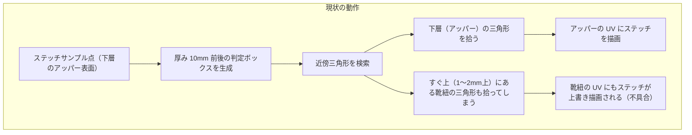
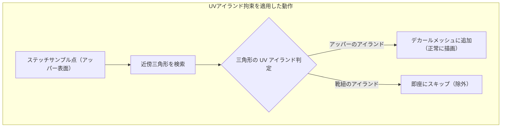

# 重なりメッシュへの誤描画防止（UVアイランド拘束）仕様書

## 1. 背景と課題

### 1.1 背景
靴（スニーカー）の靴紐とアッパー、衣服の襟やポケット、装飾ベルト、ハトメ金具など、アバターや衣装の 3D モデルでは**複数のパーツが至近距離（数ミリ以下）で重なり合っている形状**が頻繁に存在します。
これらは 1 つの SkinnedMeshRenderer / MeshRenderer 内で同一サブメッシュ（マテリアル）にまとめられているケースが多く見られます。

### 1.2 現状の課題
現在、StitchMaker のデカールメッシュ構築（[`DecalMeshBuilder.cs`](../../Editor/Core/DecalMeshBuilder.cs)）は、ステッチのサンプル点（3D 座標）を中心とした直方体バウンディングボックス（厚み $2 \times \text{depth} = 2 \times \max(\text{length}, \text{width})$）を用いて近傍の三角形を収集しています。



これにより、下層の布地に沿って引いたステッチが、すぐ上に重なっている**靴紐や金具の表面ポリゴンにも投影され、上書きベイクされてしまう**という問題が発生します。

---

## 2. 解決アプローチの比較検討

| アプローチ | 概要 | メリット | デメリット・課題 | 判定 |
| :--- | :--- | :--- | :--- | :---: |
| **案1: UV 空間での直接直線補間** | 2 つのノードが同一 UV アイランドにある場合、UV 上で直線を結んで完結させる | UV 上で完結するため別パーツには絶対に出ない | ・UV の伸縮・歪みにより 3D 上でステッチ間隔やサイズが狂う<br>・シームまたぎに対応できない | × |
| **案2: デカール深度の非対称化・制限** | 法線のプラス側（表面から浮く側）の判定厚みを極小（0.2mm等）にする | 実装が軽量 | ・サンプル点はベジェ曲線上にあり表面上にはない。凸面ではノード間の曲線が表面より内側を通るため、表面が法線プラス側にずれ、正常なステッチまで欠ける<br>・完全密着（0 距離）の場合は防げない | × (不採用、§4.1) |
| **案3: UV アイランド拘束 (Island Constrain)** | パスが乗っている UV アイランドを特定し、そのアイランドのポリゴンにのみデカールを貼る | **・三角形ごとの判定は配列参照 1 回**<br>**・完全密着していても除外可能**<br>・3D ベジェの滑らかさを完全に維持 | UV シーム（切れ目）をまたぐステッチで誤って遮断されない配慮が必要 | **◎ (採用)** |

**結論:**
アッパーと靴紐は 3D 空間では重なり合っていても、**UV 展開上では完全に別々の UV アイランド（独立したポリゴングループ）に分かれています**。
したがって、**「案3: UV アイランド拘束」を主軸とし、「シーン編集時のアイランド優先レイキャスト」を補助機能として組み合わせる構成**を採用します。案2 は副作用が大きいため採用しません。

---

## 3. 基本仕様・設計方針

### 3.1 UV アイランドの自動検出（`MeshSnapshot` 初期化時）
メッシュ読み込み時に、三角形同士の UV 接続関係を解析して各三角形に `IslandId`（`0, 1, 2...`）を割り当てます。対象は `MeshSnapshot` が保持するサブメッシュの三角形のみです。

- **「同じ UV 頂点」の定義**: **位置と UV0 が両方とも一致する頂点**を同一とみなします（ビット単位の完全一致）。
  - ハードエッジ（法線の分割）で頂点が複製されている箇所は、位置も UV も同じなので**結合されます**（アイランドが不必要に分断されない）。
  - UV シームは、位置が同じでも UV が異なるので**結合されません**（アイランドの境界になる）。
  - UV だけで判定すると、左右で UV を重ねたメッシュや、別パーツの頂点がたまたま同じ UV にある場合に無関係なアイランドが結合されるため、位置も条件に含めます。
- **アルゴリズム**:
  1. 各頂点を (位置, UV) のキーで代表頂点へまとめる（`Dictionary`）。
  2. 三角形の 3 頂点の代表頂点同士を Union-Find で結合する。
  3. 根ごとに連番を振り、三角形の `IslandId` とする。
  - 計算量はほぼ線形で、10 万ポリゴン規模でも初期化時に数十 ms 以内。1 度だけ計算してキャッシュします。

### 3.2 パスと UV アイランドの関連付け（許可アイランド）
許可アイランドは**シリアライズせず、ベイク（プレビュー含む）のたびにパスのノード位置から求めます**。

- ノードに三角形インデックスを保存する方式は採りません。「メッシュを再取得」やマテリアル切り替えで三角形の並びが変わると壊れ、ミラー側の（吸着後の）ノードにも対応できないためです。
- **手順**（`IslandFilter.Collect`）:
  1. 各ノードについて、ノード位置付近（半径 `NodeSearchRadius` = 1mm）でノード法線と同じ側を向いた三角形のうち最も近いものを探し、そのアイランドを許可する。ノードは Raycast で表面上に置かれているため、通常は距離 0 の三角形が見つかる。
  2. 隣り合うノードのアイランドが異なるセグメント（シームをまたぐ区間）は、そのセグメントの折れ線の各点（16 分割）で同様に三角形を探し、見つかったアイランドも許可する。両端と異なる第 3 のアイランド（細い帯状のパーツなど）を経由する場合の取りこぼしを防ぐ。
     - 曲線上の点は表面上にないため、ノードより広い半径（`SegmentSearchRadius` = 1cm）で探す。候補が複数あれば法線方向に最も近い面を採る（`TrySnapToSurface` と同じ基準）。
     - 両端が同じアイランドのセグメントは調べない（凹面で曲線が表面から浮き、上に重なった靴紐の方が近くなって誤って許可される事故を避ける）。
  3. ミラーが有効なパスでは、ミラー側（吸着後）のノード列にも同じ処理を行い、許可アイランドに加える。
  4. 1 つも見つからなかった場合（ノードが表面から外れているなど）は、拘束しない（従来どおり全アイランドに描く）。
- 許可アイランドは `bool[IslandCount]` で持ち、`DecalMeshBuilder` からは配列参照 1 回で判定します。

**既知の制約**: 両端が同じアイランドにあるセグメントが、途中で別のアイランドを横切る場合、その部分は描かれません。横切るアイランド上にノードを 1 つ置くか、アイランド限定を OFF にしてください。

### 3.3 デカール三角形のフィルタリング（`DecalMeshBuilder`）
ステッチサンプル点の近傍三角形を走査する際、以下の条件でフィルタリングを行います（溝のデカールにも同じ許可アイランドを使います）：

```csharp
// allowedIslands が null なら拘束しない
if (allowedIslands != null && !allowedIslands[islands[candidate]]) continue;
```

これにより、ステッチサンプルの直上に靴紐が存在していても、靴紐の三角形は即座にスキップされ、**靴紐の UV には一切ステッチが描画されなくなります**。



### 3.4 パス設定へのトグル追加
**`StitchPath`** に以下の項目を追加します（`StitchSettings` には入れません）。

- 理由: `StitchSettings` はプリセット・設定のコピー / 貼り付けの対象で、プリセット適用時は既定値に戻してから上書きされるため、パスの形状に依存するこの設定が意図せず変わってしまいます。ミラー設定と同じく「パスの属性」として扱います。
- **`アイランド限定 (Island Constrain)`**: 既定値 **ON**（既存のパスアセットを読み込んだ場合も ON）
  - **ON**: パスが乗っているパーツ（UV アイランド）にのみステッチを描画します。入り組んだ靴紐や重なり合う襟・ポケットの下にステッチを引く場合に最適です。
  - **OFF**: 従来の動作（3D 空間の近傍すべてに投影）。特殊な立体構造で意図的に別パーツへ跨がせたい場合などに使用します。
- パスの複製・ミラーの実体化では引き継ぎます。「+ パスを追加」では引き継がず既定値（ON）とします（ミラー設定と同じ扱い）。

---

## 4. 補助機能

### 4.1 デカール投影深度の非対称化（不採用）
当初案では法線プラス側の判定厚みを `depth * 0.2` に制限する予定でしたが、以下の理由で採用しません。

- `StitchSample.position` はノード間の 3D ベジェ曲線上の点であり、メッシュ表面上の点ではありません。凸面（つま先など）ではノード間の曲線が表面より内側を通るため、表面は法線プラス側に数 mm ずれることがあり、外側を絞ると正常なステッチが欠けます。
- アイランド限定 OFF のときに「従来の動作」に戻らなくなります。
- 重なったパーツの巻き込みはアイランド拘束で解決できます。

### 4.2 シーン編集時の「アイランド優先レイキャスト」
靴紐の隙間など、手前に障害物がある場所へノードを配置しやすくするための操作改善です。

- **課題**: シーンビュー上で靴紐の隙間付近をクリックした際、手前の靴紐に Raycast が当たってしまい、アッパー表面にノードを置けない。
- **仕様**:
  - 対象: 選択中のパスで**アイランド限定が ON** かつ**ノードが 1 つ以上ある**とき。クリックによるノード追加・線上への挿入・ノードのドラッグ移動・ハンドルのドラッグに適用します。
  - 優先アイランド: そのパスのノードが乗っているアイランド（§3.2 の手順 1 のみ。ミラー側は含めない）。
  - レイ上の表向きの交点をすべて調べ、最も手前の交点から `PassThroughDepth`（1cm）以内にある優先アイランドの交点のうち最も手前のものを採用します。無ければ通常どおり最も手前の交点を使います。
    - 奥行きの上限は、靴の反対側の内壁など、遠く離れた同じアイランドの面へ吸着してしまうのを防ぐためです。
  - 優先アイランドの面が後ろに無い場所（シームの向こうの別アイランドなど）では通常の交点になるため、パスを別アイランドへ延ばす操作はそのまま行えます。
  - **Ctrl を押している間は優先を解除**し、常に最も手前の面を使います（手前の別パーツへ意図的にノードを置く場合）。
  - シーンビュー右下の操作ガイドに「Ctrl：手前の面を優先（アイランド優先を解除）」を追加します。

---

## 5. 詳細設計と変更対象ファイル

### 5.1 `MeshSnapshot.cs`
- **追加メンバー**:
  ```csharp
  public readonly int[] TriangleIslands; // 各三角形 (Triangles.Length / 3) のアイランドID
  public int IslandCount { get; private set; }
  ```
- **アイランド解析**: コンストラクタで `BuildIslands()` を実行（§3.1）。
- **表面の三角形探索**: `TrySnapToSurface` の探索部分を共通化し、吸着先の三角形インデックスを返す `FindSurfaceTriangle(Vector3 position, Vector3 normalHint, float radius)` を追加（見つからなければ -1）。
- **アイランド優先レイキャスト**: `Raycast(Ray ray, bool[] preferredIslands, float passThroughDepth, out position, out normal)` を追加（§4.2）。`preferredIslands` が null なら既存の `Raycast` と同じ結果。

### 5.2 `StitchPath.cs` / `StitchDocument.cs` / `PathSampler.cs`
- **`StitchPath`**: `public bool islandConstrain = true;`
- **`StitchDocument.DuplicatePath`**、**`PathSampler.CreateMirroredPath`**: `islandConstrain` を引き継ぐ。
- **`PathSampler`**: ミラー側のノード列を外部から使えるよう、`MirrorNodes` の結果を返す API（`BuildMirroredNodes`）を公開する。

### 5.3 `IslandFilter.cs`（新規、`Editor/Core`）
- `public static bool[] Collect(StitchPath path, MeshSnapshot snapshot)`: §3.2 の許可アイランドを求める。拘束 OFF・見つからない場合は null。戻り値の配列は内部で再利用する（呼び出し側は次の呼び出しまでに使い切る）。
- `public static bool[] CollectNodeIslands(StitchPath path, MeshSnapshot snapshot)`: §4.2 の優先アイランド（ノードのみ）を求める。

### 5.4 `DecalMeshBuilder.cs` / `TextureBaker.cs`
- `Build` の 2 つのオーバーロードに `bool[] allowedIslands`（null 可）を追加し、三角形の走査ループ冒頭で判定する。
- `TextureBaker.Draw` で、パスごとに `IslandFilter.Collect` を 1 回呼び、溝とステッチの両方の `Build` に渡す。プレビューも `TextureBaker` を通るため同じ結果になる。

### 5.5 `ScenePathEditor.cs` / UI
- **ScenePathEditor**:
  - ノードの追加・挿入・ドラッグで使う Raycast を、§4.2 のアイランド優先版に置き換える（優先アイランドはドラッグ開始時 / クリック時に求める）。
  - 操作ガイドに Ctrl の行を追加。
- **StitchMakerWindow (UXML / C#)**:
  - ステッチ設定カードのミラー設定の上に「アイランド限定」トグルを追加（パスの属性なので区切り線の下、ミラーと同じグループ）。
  - ツールチップ: 「パスが乗っているパーツ（UV アイランド）にだけステッチを描き、上に重なった靴紐や襟などへの漏れを防ぐ。シーンビューでは手前の別パーツ越しにクリックしても、パスのパーツへノードを置く」
- **Loc.cs**: ラベル・ツールチップ・操作ガイドの英訳を追加。

### 5.6 ドキュメント
- `requirements.md`（データモデル・デカール構築・シーン操作）、`user_manual_ja.md` / `user_manual_en.md` に追記する。

---

## 6. 検証・テスト計画

1. **靴紐・重なりパーツでの描画テスト**:
   - 靴紐の下を通るようにアッパーにステッチを引き、靴紐のテクスチャ（UV）にステッチが一切焼き込まれていないことを確認する。
2. **UV シーム（切れ目）をまたぐステッチのテスト**:
   - 袖や胴体など、UV シームをまたぐパスで、シームの両側のアイランドにステッチが途切れず正常に描画されることを確認する。
   - ハードエッジ（法線分割）のある箇所でアイランドが分断されず、ステッチが途切れないことを確認する。
3. **ミラー**: ミラー ON のパスで、ミラー側にもステッチが描かれることを確認する。
4. **トグル切り替え（ON/OFF）の動作確認**:
   - 「アイランド限定」を OFF にした際、従来の投影挙動に戻ることを確認する。
   - プリセットの適用・設定の貼り付けでトグルが変わらないこと、既存のパスアセットを読み込むと ON になることを確認する。
5. **アイランド優先レイキャスト**:
   - 靴紐の隙間付近をクリック / ドラッグして、アッパーにノードが置かれることを確認する。Ctrl 押下時は靴紐に置かれることを確認する。
6. **パフォーマンス検証**:
   - 10 万ポリゴン規模のモデルを読み込んだ際の初期化時間（アイランド検出）が 50ms 程度に収まることを確認する。
   - ベイク処理時間およびシーンビューでのノードドラッグの追従性に体感できるオーバーヘッドが生じないことを確認する。
